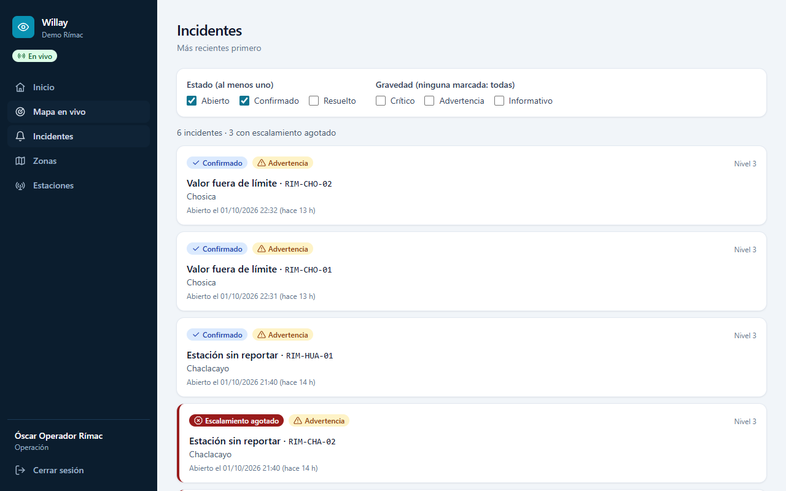
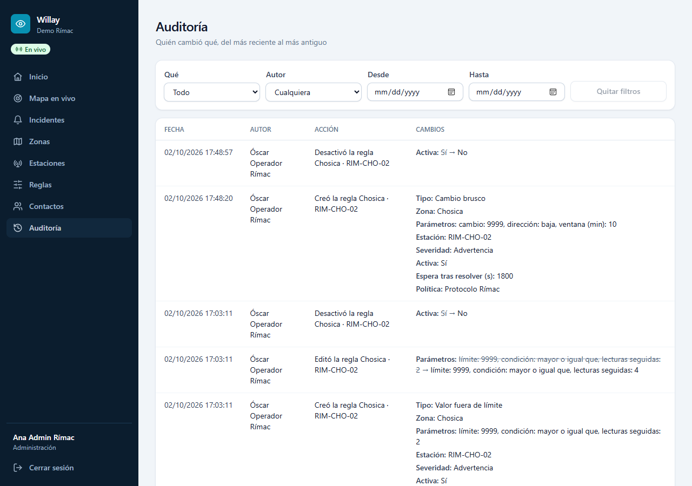

# Willay

Multi-tenant early warning system: it ingests sensor readings, evaluates rules per risk zone (threshold, rate of change, silent sensor), opens incidents without duplicates and dispatches alerts by email and Telegram, with automatic escalation if nobody confirms.

> **Support tool.** Willay helps operators and community leaders detect, decide and warn. It does not replace the official public warning systems (INDECI, regional COERs, SISMATE).

"Willay" is Quechua for "to warn, to inform". "Vigía" was the code name during the first sprints; story IDs keep its `VIG-` prefix. The full specification is in [docs/SPEC.md](docs/SPEC.md) and the technical decisions in [docs/adr/](docs/adr/).

## Requirements

- Linux, or Windows: the commands run in WSL2 (Ubuntu), PowerShell or Git Bash.
- Docker Engine on Linux, or Docker Desktop on Windows (with the WSL integration enabled if you use WSL).
- [uv](https://docs.astral.sh/uv/) for the backend (it installs Python 3.12 if missing).
- Node.js 24 LTS for the dashboard (`nvm install` reads `dashboard/.nvmrc`).
- GNU `make`. On Windows without WSL: `winget install ezwinports.make`.

Before the first `make up`, check that `docker info` and `make --version` respond in the shell you will use. The ports in `.env` must also be free: 5433 (Postgres), 8080 (Keycloak), 8000 (API), 4200 (dashboard) and 8025 (Mailpit). If another project is using any of them, Willay's containers stay in `Created` and `make up` fails.

With WSL, clone the repo inside the WSL file system (for example `~/code/willay`), not in `/mnt/c`. Bind mounts and `node_modules` on `/mnt/c` are slow.

## Starting it

```bash
cp .env.example .env    # and fill in the values
make up                 # postgres, keycloak, mailpit, migrate, api, 5 workers, dashboard
make seed               # demo data; prints the simulator's API keys
```

## The dashboard

http://localhost:4200, with the demo users `rimac-admin`, `rimac-operator`, `rimac-responder` and `rimac-viewer` (password: `WILLAY_DEV_USER_PASSWORD` in `.env`). Each sees what their role allows.

- **Mapa en vivo:** zones by their most urgent incident, stations with their last value, whether they report and a badge with their incident's state.
- **Incidentes:** the inbox, filtered by status and severity in the URL.
- **Incident detail:** readings chart, alerts by recipient and timeline; acknowledge, resolve and comment according to the role.
- **Reglas:** the rules by zone, in words; operator and admin create, edit and deactivate them, with a preview of where a draft would have opened incidents over the last 24 h.
- **Contactos:** contacts and their groups, with the channels each can be reached by; admin manages them and generates Telegram links.
- **Auditoría** (admin): who changed what and when, each field before and after.
- New incidents are announced on every page, and so are readings the evaluator could not process (with a link to reprocess them); everything updates live.







## Development

```bash
make help   # lists all the commands
make lint   # Ruff, Mypy strict, ESLint
make test   # Pytest (unit + integration with real Postgres via Docker) and Vitest
```

## Station simulator

It sends real readings to `POST /v1/readings` with the API keys that `make seed` left in `.secrets/station-keys.json`. The same seed always produces the same series of values. It runs in real time (one batch per station every 10 s) because silence detection measures with the real clock.

```bash
make simulate ARGS="--scenario normal --stations 3 --seed 7 --steps 12"
make simulate ARGS="--scenario rimac --seed 42"   # demo: drop downstream and, 4 min later, silence upstream
```

Scenarios: `normal`, `rise` (the value doubles in 5 min), `drop` (falls to 40 %), `silence` (stops reporting) and `rimac`. `--event-after` sets when the event starts (60 s by default).

With the seed data, Willay opens incidents and alerts: `rise` triggers the threshold rule of RIM-CHO-01, and `rimac` the discharge drop of RIM-CHA-01 and, 4 minutes later, the silence of RIM-SEU-01.

The Rímac policy has 3 levels:
- Level 1: email to Óscar.
- Level 2, if nobody confirms within 2 min: email and Telegram to Brigada Chosica.
- Level 3, 3 min later: Jefatura COE.

Confirming any alert, either with the email link or with the Telegram button, stops the escalation. The emails can be seen in Mailpit (http://localhost:8025).

A cause that was just resolved or acknowledged does not open a new incident while it is still active or during its cooldown (30 min in the seed). To repeat the scenario right away, start from an empty database (`docker compose down -v`, `make up` and `make seed`).

## Telegram alerts (optional)

Without a bot, the `telegram` worker starts disabled and Telegram alerts stay pending; email works the same. To enable it:

1. Create a bot with [@BotFather](https://t.me/BotFather) (`/newbot`).
2. Put its token and its username (without `@`) in `.env`: `WILLAY_TELEGRAM_BOT_TOKEN` and `WILLAY_TELEGRAM_BOT_USERNAME`. The token is a secret: it never goes into the repository.
3. Run `make up` so that the API and the workers read it.
4. Generate a contact's link as admin and open it in Telegram. The example is for Rosa Brigada, from level 2 of the seed; the dashboard will have a button for this with VIG-36.

```bash
JWT=$(curl -s http://localhost:8080/realms/willay/protocol/openid-connect/token \
  -d grant_type=password -d client_id=willay-dev-cli -d username=rimac-admin \
  --data-urlencode "password=$(grep '^WILLAY_DEV_USER_PASSWORD=' .env | cut -d= -f2-)" \
  --data-urlencode 'scope=openid organization:*' \
  | python3 -c 'import sys, json; print(json.load(sys.stdin)["access_token"])')
curl -s -X POST -H "Authorization: Bearer $JWT" \
  http://localhost:8000/v1/contacts/01a0dc43-cd2d-7522-8430-8819717232b6/telegram-link
```

The link is valid for 7 days and can be used only once; a new one cancels the previous one. Only the person who received an alert can confirm it with its button.

## Structure

| Folder | Contents |
| --- | --- |
| `backend/` | Python package `willay`: FastAPI API, workers, Alembic migrations and tests |
| `dashboard/` | Angular dashboard |
| `infra/` | Keycloak realm and Postgres init scripts |
| `docs/` | SPEC, ADRs, interviews, sprints and runbooks |
