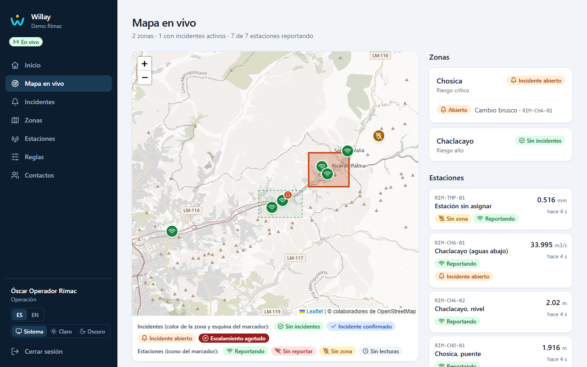
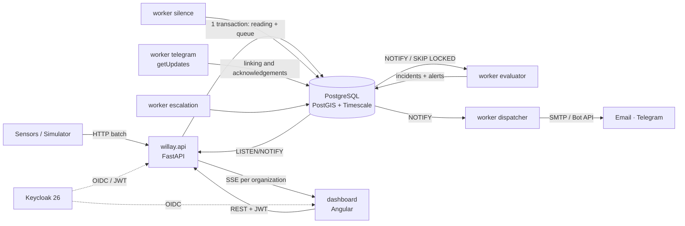
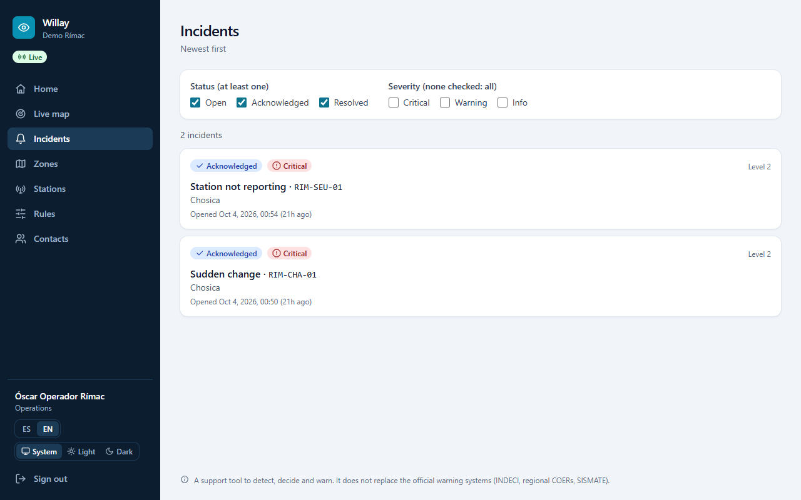
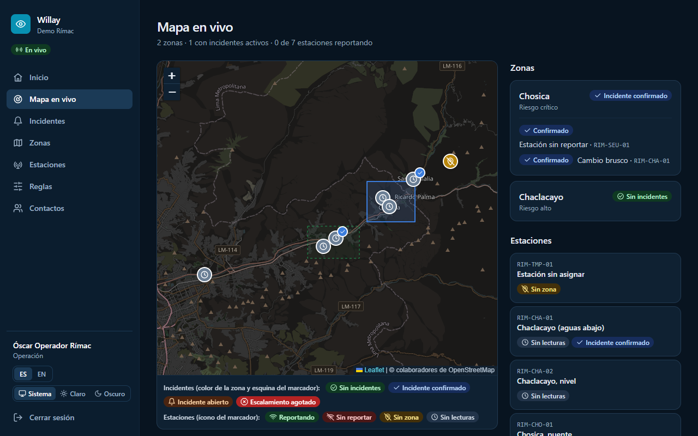
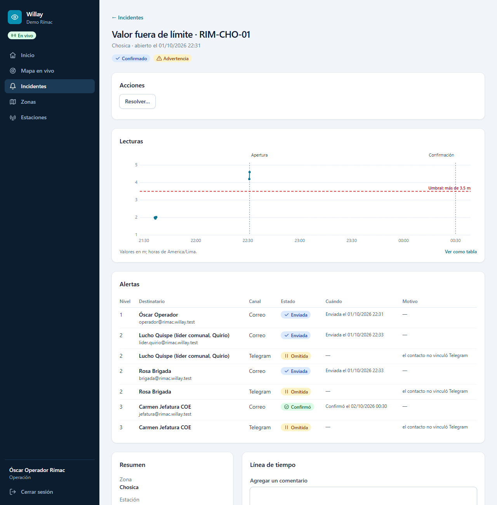
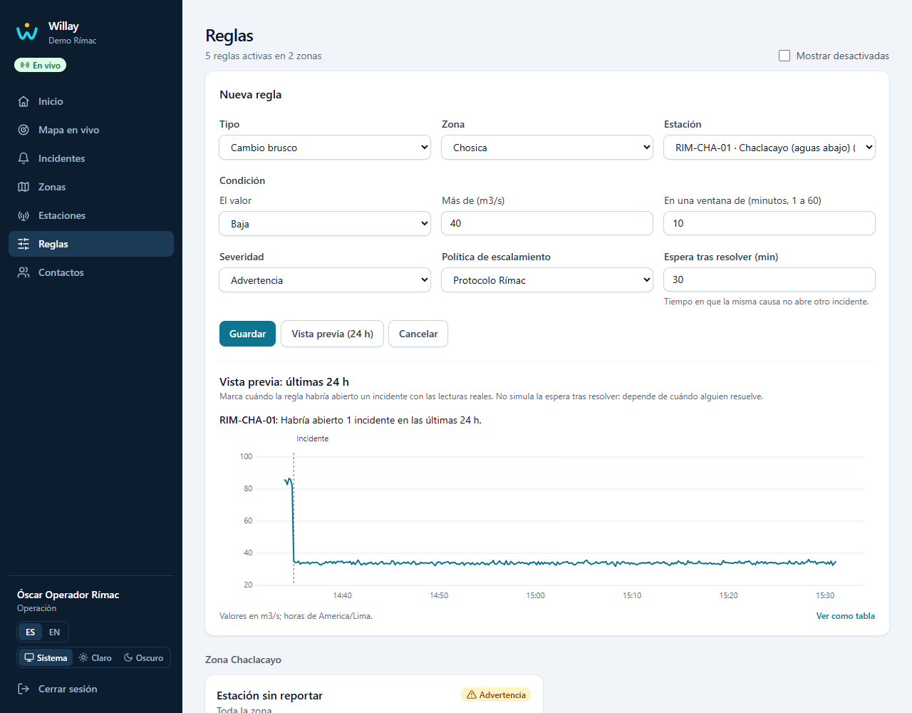
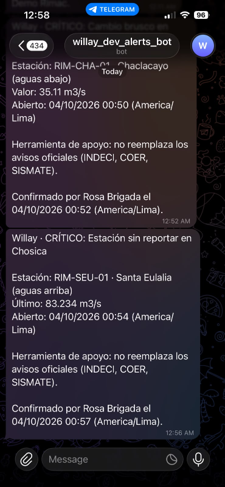

# Willay

**The modern early warning layer for floods and debris flows.**

Today, between a sensor that detects an anomaly and the person who must act, there is a phone chain, a WhatsApp group and minutes lost. Monitoring portals show the data, but nobody decides or escalates.

Willay replaces that chain. It evaluates every reading as it arrives, opens the incident without duplicates, alerts the right people by email and Telegram in seconds, and escalates level by level until someone acknowledges. Even a sensor that goes silent in a risk zone is a signal, not a maintenance chore.

"Willay" is Quechua for "to warn, to inform".



## Try it

**Live demo: [willay.duckdns.org](https://willay.duckdns.org)**

The demo runs with simulated data. Sign in with one of these accounts. The password, `willay-demo`, is also shown on the sign-in screen.

| Account | Can |
| --- | --- |
| `demo-admin` | See and manage everything, and run the scenario |
| `demo-operator` | Manage zones, stations, rules and incidents |
| `demo-viewer` | Only look |

What to try:

1. **Run the scenario.** Sign in as `demo-admin` and press **Run the scenario** on Home. It plays SPEC's Rímac story in 9 minutes: discharge drops at Chaclacayo, and 4 minutes later the Santa Eulalia station stops reporting.
2. **Watch the live map.** The first incident opens within a minute, and the zone changes colour. No reload is needed: the dashboard listens to the database over SSE.
3. **Read the alerts.** **See the emails sent** opens the mailbox that catches every alert. Nobody acknowledged? Two minutes later the next level is alerted.
4. **Acknowledge.** Do it from the incident, or with the link in its email. The escalation stops, and the timeline records who did it and how.
5. **Look around:** the incident's readings chart and timeline, the rules in plain words with a 24-hour preview, the audit log, English or Spanish, light or dark, and a 360 px phone screen.

Every night at 04:00 (Lima time) the demo goes back to its initial state.

## Why it exists

In the Rasuwa flood (Nepal, August 2026), the Bhote Koshi–Syafrubesi hydrological station stopped transmitting about ten minutes after the river overflowed, and downstream warnings went out 25 minutes later. The station's silence was the first available signal. Having sensors is not having a system: what is missing is the layer that connects data, rules and people. That layer is Willay. The first market is risk management offices of Peruvian municipalities facing huaicos (debris flows) and the coastal El Niño.

## Highlights

- **No reading is lost.** Postgres is the queue (ADR-0002). The reading and its queue row are written in the same transaction. Workers claim rows with `FOR UPDATE SKIP LOCKED`, commit their attempt before evaluating, and set aside a row that fails five times so it cannot block the rest. `LISTEN/NOTIFY` wakes them, with polling as a fallback.
- **Measured.** 50 stations, one reading every 10 s, for 30 minutes (`make loadtest`): 9,000 batches, none lost, every reading evaluated, and a p95 under 0.2 s from reading received to first alert sent, against a 30 s target.
- **Silence is a signal.** A station that stops reporting opens its own incident after K times its expected interval, and records when it comes back.
- **Incidents without duplicates.** One active incident per cause, held by a partial unique index even with several evaluators racing. A cooldown keeps a resolved cause from reopening, and the timeline is append-only at the database permission level.
- **Multi-tenant.** Organizations come from Keycloak 26 Organizations, and every query and every live event is scoped to one. Isolation is tested on every endpoint and on the SSE channel.
- **Escalation by levels.** Each level alerts groups by channel and waits; nobody acknowledging moves it up. Acknowledging takes one click from the email (a page with a Confirm button, so mail scanners cannot acknowledge) or from a Telegram button that only works for the recipient.
- **Architecture that holds.**
  - One Python package deployed as an API and separate workers (ADR-0001).
  - Each module has domain, application, infrastructure and API layers, and import contracts fail the build if a boundary is crossed.
  - Time is injected, so silence and escalation are tested without waiting.
- **An accessible, bilingual dashboard.**
  - Angular with signals; Spanish and English, and so are the alerts each contact receives.
  - Light and dark themes, and no status is conveyed by colour alone.
  - axe-core checks every view, and Playwright checks the main ones at 360 px in a real browser.

## Quality

- **Checked against its own specification.** An audit went through the 198 acceptance criteria of the MVP's stories: 172 are proved by an automated test, and the rest in part or by review.
- **Architecture rules that fail the build.** Five import contracts keep the domain free of FastAPI and SQLAlchemy, keep each module out of the others' infrastructure, and keep workers out of the API. Ruff bans the system clock outside the injected `Clock`.
- **Tests:**
  - 990 backend tests: unit, and integration against a real Postgres in Docker;
  - 336 dashboard tests, including one that fails on any text not taken from the translation files;
  - 32 checks in a real browser: every main page at 360 px, in Spanish and English, and the theme switch;
  - 16 checks of a deployed server: one hostname, the Willay icon on the sign-in page, Keycloak's admin and account consoles closed.

## Architecture



**Stack:**
- **Backend:** Python 3.12, FastAPI, SQLAlchemy 2 async, Alembic, structlog.
- **Database:** PostgreSQL 16 with PostGIS and TimescaleDB.
- **Identity:** Keycloak 26 with Organizations.
- **Dashboard:** Angular, Leaflet and Tailwind CSS.
- **Infrastructure:** Docker Compose; on a server, Caddy with automatic HTTPS on one hostname (ADR-0010).

**Documentation:**
- [docs/SPEC.md](docs/SPEC.md): vision, scope, architecture, schema, backlog and engineering rules.
- [docs/adr/](docs/adr/): the technical decisions.
- [docs/runbooks/](docs/runbooks/): deploy, back up and restore, rotate API keys, reprocess failed readings.

| | |
| --- | --- |
|  |  |
|  |  |

## Run it locally

You need:
- Docker: Docker Engine on Linux, or Docker Desktop on Windows.
- GNU `make`. On Windows without WSL: `winget install ezwinports.make`.
- [uv](https://docs.astral.sh/uv/) for the backend. It installs Python 3.12 if missing.
- Node.js 24 for the dashboard. `nvm install` reads `dashboard/.nvmrc`.

```bash
make up      # creates .env from .env.example, then brings up Postgres, Keycloak, Mailpit,
             # the migrations, the API, the workers and the dashboard
make seed    # two organizations with zones, stations, rules, contacts and a 3-level policy
make demo    # the Rímac scenario, narrated in the terminal (about 8 minutes)
```

- **Dashboard:** http://localhost:4200. Sign in as `rimac-admin`, `rimac-operator`, `rimac-responder` or `rimac-viewer`; the password is `WILLAY_DEV_USER_PASSWORD` in `.env`.
- **Emails:** in Mailpit, http://localhost:8025.

The ports in `.env` must be free: 5433 (Postgres), 8080 (Keycloak), 8000 (API), 4200 (dashboard) and 8025 (Mailpit). If another project uses one, change it in `.env` (`WILLAY_API_PORT`, `WILLAY_KEYCLOAK_PORT`…) before `make up`: the dashboard follows. With WSL, clone inside the WSL file system rather than `/mnt/c`, which is slow for bind mounts.

To put it on a server for others to try, follow [docs/runbooks/deploy.md](docs/runbooks/deploy.md).

### The guided demo

`make demo` plays the scenario and tells each step of both incidents' timelines as it happens, with links to the dashboard:

| Time | What happens |
| --- | --- |
| 1:00 | The drop opens an incident; level 1 (Óscar) gets an email |
| 3:00 | Nobody acknowledged: level 2 (Brigada Chosica) gets Telegram and email |
| 5:00 | Santa Eulalia goes silent: a second incident, which climbs the same levels |

Level 2 acknowledges both incidents:
- **With Telegram linked:** you press «Confirmar que lo vi» on each message.
- **Without it:** the demo acknowledges as Rosa Brigada through the page her email links to (`make demo ARGS="--confirm email"`).

The demo ends with PASS when both are acknowledged at level 2. Watch it as `rimac-viewer`, who cannot acknowledge and so cannot end the story early. Each run starts from a clean slate and keeps the configuration.



### Development

```bash
make help    # lists all the commands
make lint    # Ruff, Mypy strict, import contracts, ESLint
make test    # Pytest (unit + integration with a real Postgres via Docker) and Vitest
make e2e     # the main views at 360 px in a real browser, against the running stack
make latency ARGS="--minutes 60"   # p50/p95 of reading received -> first alert sent
make loadtest ARGS="--minutes 30"  # 50 stations x 1 reading/10 s against the running stack
make simulate ARGS="--scenario rimac --seed 42"   # real readings into the local API
```

**The simulator.** It sends readings with the API keys that `make seed` saved in `.secrets/station-keys.json`, and the same seed always gives the same series.
- **Scenarios:** `normal`, `rise`, `drop`, `silence` and `rimac`.
- **With the seed data:** `rise` triggers RIM-CHO-01's threshold rule, and `rimac` triggers RIM-CHA-01's discharge drop and, 4 minutes later, RIM-SEU-01's silence.

**Telegram (optional).** Without a bot, Telegram alerts stay pending and email works the same. To enable it:
1. Create a bot with [@BotFather](https://t.me/BotFather).
2. Put `WILLAY_TELEGRAM_BOT_TOKEN` and `WILLAY_TELEGRAM_BOT_USERNAME` in `.env`. The token is a secret.
3. Run `make up` again.
4. In **Contactos**, generate a contact's link and open it in Telegram. The link is single use and valid for 7 days, and only an alert's recipient can confirm it with its button.

| Folder | Contents |
| --- | --- |
| `backend/` | The `willay` Python package: API, workers, Alembic migrations and tests |
| `dashboard/` | The Angular dashboard |
| `e2e/` | Browser checks with Playwright |
| `infra/` | Keycloak realm and sign-in theme, Postgres init, Caddy and the server's `.env` script |
| `docs/` | Specification, ADRs, runbooks and sprint notes |

## About

Built by [Alessandro David](https://github.com/Alesso2805) as a portfolio project: specification, architecture, backend, dashboard and deployment, in two-week sprints. Story IDs keep `VIG-`, from the project's code name, Vigía.

Found a security issue? See [SECURITY.md](SECURITY.md). Licensed under the [MIT License](LICENSE).
