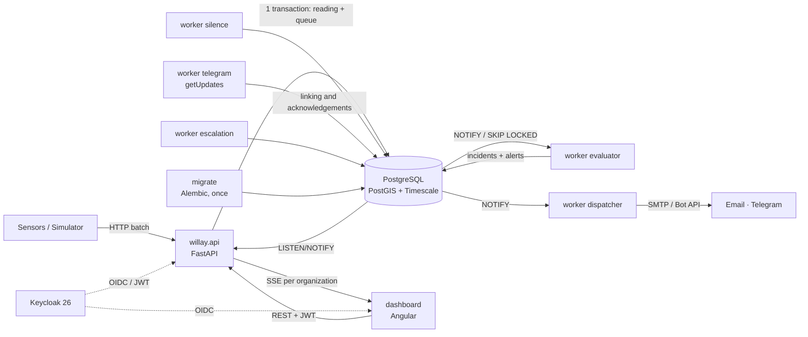
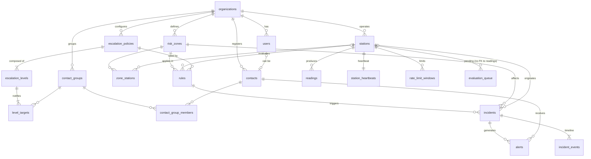

# Willay — MVP specification and development prompt

Sep 25, 2026 · @Alessandro David

## Vision and problem

Willay cuts from minutes to seconds the time between an anomalous data point appearing and operators and community leaders receiving the alert, without depending on a human phone call.

**About the name.** The product is called **Willay**, Quechua for "to warn, to inform" (chosen on October 1, 2026): short, easy to say in Spanish and English, and rooted in the first market. Known risks: a public ICT program in Peru already used the word, and it may be confused with Willax, a Peruvian television channel; the trademark must be checked with INDECOPI before any commercial use. Earlier options were discarded: "Yaku", the name of the cyclone that caused severe flooding in northern Peru in 2023, and "SAT", which in Lima is the Servicio de Administración Tributaria (the tax administration service). "Vigía" was the code name during the first sprints; on October 1, 2026 the repository, the code package, the database and its roles, the environment variables, the notification channels and the Keycloak realm were renamed to `willay`. Story IDs keep the `VIG-` prefix so that they still match the commits and pull requests that cite them.

**The problem.** In the Rasuwa flood (Nepal, August 26, 2026) the river overflowed around 8:40 according to the government ([Rising Nepal](https://risingnepaldaily.com/news/85570)). The Bhote Koshi–Syafrubesi hydrological station stopped transmitting around 8:50, and the DHM confirmed the flood wave and issued downstream warnings at 9:15 ([NDRRMA, SitRep](https://ndrrma.gov.np/mediafiles/rasuwa/Rasuwa_Flood_SitRep_Temp_ENG_01_01092026.pdf)). About 35 minutes went by, and the station's silence was the first available signal. Having sensors is not having a system: what is missing is the layer that connects data, rules and people.

**The proposal.** A web platform that ingests sensor data, evaluates configurable rules and dispatches multichannel alerts with automatic escalation. It treats the silence of a sensor in a risk zone as a possible event, not as a maintenance failure.

**Positioning.** Willay is a support tool for operators and community leaders: detect, decide and warn. It does not replace official dissemination to the public (INDECI, regional COERs, the MTC's SISMATE) and is designed to integrate with it later through the CAP standard.

**Target users.** Risk management offices of small and medium-sized municipalities (first market: Peru, because of huaicos and the Niño costero, i.e. debris flows and coastal El Niño), prevention NGOs and critical infrastructure operators (hydroelectric plants, mines).

**Long-term roadmap**

1. MVP (this document): data → rule → incident → alert → acknowledgement cycle.
2. Phase 2: public citizen subscription page, SMS, CAP export, context layer with discharge forecasts.
3. Candidate phase 3 (to be confirmed): predictive models, for example estimating the probability of a huaico from accumulated rainfall and discharge. Reason to keep the backend in Python.

**MVP goals**

- Demonstrate an end-to-end alert in under 30 s from the moment the anomalous reading is accepted.
- Detect a silent sensor in under K × expected interval + 30 s (K = `stations.silence_multiplier`, 3 by default).
- Record an auditable timeline of every incident that survives the expiration of the readings.
- Serve as a portfolio project with a solid, geospatial, event-driven Python backend.

**Success metrics**

| Metric | MVP target | How it is measured |
| --- | --- | --- |
| Accepted reading → first alert sent | < 30 s (p95) | `alerts.sent_at − readings.received_at` |
| Silent sensor → incident | < K × interval + 30 s | `incidents.opened_at − station_heartbeats.last_seen_at` |
| Incidents acknowledged before the last level is exhausted | 100 % in the demo (level 2 acknowledges both incidents) | Per incident, not per alert |
| Readings processed without loss | 100 % with 50 stations at 1 reading/10 s for 30 min | Zero readings with quality = ok and no evaluated\_at 120 s after being received |
| Validation interviews | Postponed out of the MVP (decision of September 30, 2026; see "Validation" in the sprint plan) | — |

## Master prompt for the development agent

Save this prompt as `CLAUDE.md` at the root of the repository (single copy) and export this document as `docs/SPEC.md`. The coding agent reads `CLAUDE.md` at the start of every session.

```markdown
# Role
You are a senior software engineer who works alongside me to build "Willay" (product name; package `willay`), a multi-tenant early warning system. I (a fullstack developer) make the product decisions; you propose, implement and explain.

# Source of truth
Read docs/SPEC.md before writing code. If something I ask you contradicts SPEC.md, warn me before continuing. Every technical decision not covered is recorded as an ADR in docs/adr/NNNN-title.md.

# What Willay is
A web platform that (1) ingests sensor readings, (2) evaluates rules per risk zone (threshold, rate of change, silent sensor), (3) opens incidents without duplicates and (4) dispatches alerts by email and Telegram with automatic escalation if nobody acknowledges. Goal: p95 < 30 s between reading received and first alert sent.

# Mandatory stack
- Single backend: Python 3.12, FastAPI, SQLAlchemy 2 async + asyncpg, Pydantic v2, Alembic, uv, Ruff, Mypy (strict), Pytest, structlog, time-machine, uuid-utils (uuid v7 generated in the application).
- Frontend: Angular (a version under active support at the start; check the official release calendar), standalone components and signals, Leaflet, Tailwind CSS, `eventsource` (with its `fetch` option to send the JWT in the header) for SSE.
- Infra: PostgreSQL 16 + PostGIS + TimescaleDB (timescale/timescaledb-ha image), Keycloak 26 with Organizations, Mailpit for local email, Docker Compose.
- No Redis or external broker in the MVP: queue, notifications and rate limit live in Postgres (see ADR-0002).

# Architecture rules
- One `willay` package with modules: identity, ingestion, territory, rules, incidents, alerts, realtime. Each module with layers domain, application, infrastructure, api. The domain does not import FastAPI or SQLAlchemy.
- DB schemas `ingest` and `core` as the boundary between modules; a single Alembic migration history. No FK to the `ingest.readings` hypertable.
- Processes: `willay.api` (FastAPI) and workers as separate processes with the same code: `python -m willay.workers.evaluator`, `.silence`, `.dispatcher`, `.escalation`, `.telegram`. Never workers inside the FastAPI lifespan.
- Queue: save the reading and insert into `ingest.evaluation_queue` in the SAME transaction. The evaluator: (a) takes a row with `available_at <= now` using `FOR UPDATE SKIP LOCKED`, increments `attempts`, sets `available_at = now + 60 s` (visibility timeout) and commits in a short transaction; (b) evaluates in another transaction that writes incidents and alerts, sets `readings.evaluated_at` and deletes the row. With `attempts` ≥ 5 it sets `failed_at` and takes the row out of the queue. It wakes up with `LISTEN/NOTIFY` and fallback polling every 5 s. Wrap the queue in an `EvaluationQueue` interface.
- The dispatcher also wakes up with `NOTIFY` when alerts are created, with fallback polling every 5 s.
- Time: the whole domain receives an injected `Clock` protocol; `datetime.now()` is forbidden outside the real implementation. Tests with time-machine or a FakeClock.
- Multi-tenant: the `organization` claim of the Keycloak JWT is an object `{alias: {id}}` (scope `organization:*`, mapper with "Add organization id"); exactly one organization per user is required and any token with zero or several is rejected (403). The tenant is resolved only by the `id`. Roles come from the JWT realm roles (Keycloak is the only source) and, by the previous rule, apply to that single organization. Every query filters by `organization_id` through a mandatory dependency; the SSE channel also filters by organization.
- Ingestion rate limit in Postgres (`ingest.rate_limit_windows`), valid with several replicas.
- `core.incident_events` and `core.audit_log` are append-only: the `willay_app` role has no UPDATE or DELETE on them. Migrations run as `willay_owner` and use `ALTER DEFAULT PRIVILEGES` so that new tables grant permissions to `willay_app`.
- Configuration through environment variables; never secrets in the repository.

# How to work
1. Before each story, summarize in 3-5 lines what you will do and which files you will touch; wait for my confirmation.
2. Small commits with Conventional Commits.
3. Explain non-obvious decisions: I want to learn, not just receive code.
4. If a task exceeds ~300 lines, split it and ask me which order to follow.

# Definition of done (DoD)
- Acceptance criteria met and demonstrable.
- Domain unit tests + at least one integration test per new endpoint or worker (real Postgres via Docker).
- Green CI: Ruff, Mypy, Pytest, Angular lint and build.
- `docker compose up` brings everything up with no manual steps.
- OpenAPI and docs/SPEC.md updated if a contract changed.

# First task (Sprint 0)
Execute VIG-01 to VIG-05 of docs/SPEC.md in order:
1. Monorepo as described in SPEC, Makefile (up, down, test, lint, migrate, seed, demo) and CI on GitHub Actions.
2. docker-compose.yml with postgres, keycloak (realm imported from infra/keycloak/realm-willay.json with 2 organizations), mailpit, a `migrate` service that runs Alembic once and exits, and api, workers and dashboard depending on `migrate` having completed successfully.
3. Postgres init script with roles `willay_owner`/`willay_app` and extensions; initial Alembic migration: schemas, tables, hypertable with compression and retention, permissions, `ALTER DEFAULT PRIVILEGES` and REVOKE on the append-only tables.
4. Seed with 2 organizations (the Rímac demo and one for isolation testing), zones, stations with API keys generated and printed for the simulator, rules, one policy per organization (3 levels in Rímac) and contacts.
5. Drafts of ADR-0001 to ADR-0004.
Before ADR-0004, configure in Keycloak 26 the mapper that includes the organization id in the `organization` claim; the tenant is resolved only by that id.
When finished, show me how to verify each point and propose the next step.
```

## MVP scope and features

The MVP covers the full data → rule → incident → alert → acknowledgement cycle, with email and Telegram as channels and a simulator as the main data source.

| Module | Feature | Detail |
| --- | --- | --- |
| Ingestion | Reading intake | `POST /v1/readings` (batch ≤ 500) authenticated with a per-station API key; 60 batches/min per station |
| Ingestion | Atomic enqueueing | Reading and `evaluation_queue` row in the same transaction |
| Ingestion | Late and out-of-order readings | They are sorted by `measured_at`; if `received_at − measured_at` > 1 h they are stored with `quality = late`: they are not enqueued, do not enter rule windows and do not update the heartbeat |
| Ingestion | Simulator | Scenarios normal, rise, sudden drop and sensor shutdown, reproducible with a seed |
| Ingestion | Station heartbeat | `last_seen_at` = `received_at` of the last batch with at least one non-late reading; `last_value` and `last_measured_at` = the most recent non-late measurement |
| Territory | Risk zones | CRUD of polygons on a map, risk level, estimated population |
| Territory | Stations | CRUD with location, variable, unit, expected interval, silence multiplier and rotatable API key; the dashboard flags stations without a zone. The unit is fixed per variable (discharge m3/s, water level m, rainfall mm) so that a rule never compares different units; the code does not change after the station is created (the name does); when the API key is rotated the previous one stops working immediately and the new one is shown only once |
| Rules | Threshold | Value out of bounds for N consecutive readings with `quality = ok` (N between 1 and 60); the boundary is exact according to the operator (`gt`, `ge`, `lt`, `le`) |
| Rules | Rate of change | Variation greater than delta within a window of T minutes (rise or drop), only with `ok` readings. It is measured from peak to trough respecting their order (in a drop the peak comes before the trough; in a rise, the other way round), so it also fires on a sudden drop that partially recovers within the window. The window runs from T minutes before the evaluated reading up to that reading, both ends included; T between 1 and 60 |
| Rules | Silent sensor | Evaluated starting from the active silence rules and their stations: no reading for K × expected interval (K only in `stations.silence_multiplier`); one incident per silenced station; a station without a zone does not generate alerts; a station that never reported does not count as silent (it has not started transmitting yet); if the station reports again, the `silence` worker records station\_recovered in its next cycle and the operator resolves the incident (no automatic closing) |
| Rules | Cooldown | After an incident is resolved, the same cause does not reopen another one for `cooldown_s`; readings are recorded anyway |
| Incidents | Opening without duplicates | A single active incident per cause. While it is active, a reading that keeps firing the rule is added as a `reading_added` event only if it worsens the triggering value (a new maximum on an upper threshold, a new minimum on a lower one or in a drop); equaling it does not count, so reprocessing a reading does not duplicate events. The full series remains in the readings |
| Incidents | Evidence | The opening event stores a copy of the readings that fired the rule |
| Incidents | Lifecycle | `open` → `acknowledged` → `resolved` (resolution: resolved or false alarm). An open incident can also be resolved without acknowledging it first (e.g. an obvious false alarm); the `resolved` event records who did it. `resolved` is final |
| Alerts | Email | SMTP, visible in Mailpit locally. Plain text with zone, severity, cause, station, value, the organization's local time and acknowledgement link; a contact in two groups of the same level receives a single alert per channel. A failed send is retried 3 times (at 5, 10 and 20 s) and each failure is recorded as `alert_failed`; the timeline never stores the email address or the `chat_id` |
| Alerts | Telegram | Contact linking through a single-use link: an admin generates it, it is shown only once and the admin personally shares it with the contact through whatever means they use; it is valid for 7 days and a new one invalidates the previous one. Message with an acknowledgement button: it only acknowledges if the alert's recipient presses it (whoever presses must be the chat it was sent to; anyone else receives a notice without incident data), and once pressed the button is replaced by a note saying who acknowledged and when; worker with long polling (`getUpdates`). Without a bot token in the environment, the worker starts disabled |
| Alerts | Escalation | If nobody acknowledges within `wait_s`, counted from when that level was notified, the next level is notified; when the last level is exhausted an event is recorded and the dashboard shows the incident in red. The worker reads the policy when escalating: changes an admin makes also apply to ongoing incidents |
| Alerts | Missing channel | If the contact does not have the level's channel, it is skipped and recorded; a level with no send at all escalates immediately |
| Alerts | Acknowledgement | Random 256-bit token (43 characters in base64url, within Telegram's 64-character limit) stored as a hash, single use, 24 h. The email link opens an API page, without login, with the incident summary and a Confirm button (POST): opening the link never acknowledges, because email scanners open links on their own and would stop the escalation. If the incident was already acknowledged, the alert is recorded as seen without changing who acknowledged it; if it was already resolved, nothing is changed. Still-pending alerts of an acknowledged or resolved incident are not sent: they are marked skipped, with their reason |
| Dashboard | Live map | Zones by status, stations with last value and its age, updated via authenticated SSE isolated per organization. A zone takes the status of its most urgent active incident (escalation exhausted, open, acknowledged) or shows that it has none, and its tooltip counts its incidents by status; a station's marker shows whether it reports, plus a corner badge with the status of its most urgent active incident, so acknowledging an incident is visible on its station even when the zone keeps the color of another one; a station without a zone is marked as such on the map even if it reports, because it cannot raise alerts |
| Dashboard | Incident detail | Readings chart (the station's `ok` readings from an hour before the opening to two hours after, with the threshold line and the opening, acknowledgement and resolution marked; drawn as plain SVG with a table alternative; the copy kept in the `opened` event once the readings expire), timeline with names, alerts per recipient |
| Dashboard | Visual system | A single catalog of statuses (color, icon and text) for incidents, severities, zones and stations; no status is conveyed by color alone; navigation according to the user's permissions; usable at 360 px wide |
| Dashboard | Bilingual product | Spanish by default, English available: the dashboard follows each user's choice, and emails, Telegram and the confirmation page follow each contact's language (VIG-40) |
| Dashboard | Incident inbox | List filterable by status and severity, updated via SSE; an exhausted escalation is highlighted with text in addition to color |
| Dashboard | Incident actions | Acknowledge, resolve (resolved or false alarm) and comment from the detail view, according to permissions |
| Dashboard | Failed readings | List of the readings with `failed_at` and reprocessing; a notice in the header while there is any, because each one may be an alert that did not go out |
| Security | Identity and roles | Keycloak 26 Organizations; a user belongs to a single organization; roles admin, operator, responder, viewer |
| Administration | Contacts and groups | Audited CRUD; a contact with history (alerts or acknowledgements) is not deleted: it is removed from its groups so that it stops receiving; the dashboard can generate the Telegram link and unlink the contact's Telegram |
| Administration | Escalation policies | Editing from the dashboard (Could story; meanwhile, through the API) |
| Audit | Action log | Changes to zones, stations, rules, policies and contacts; the admin queries them from the dashboard with filters |

**Out of the MVP:** mass SMS and WhatsApp, mobile app, public citizen subscription page, users in several organizations, CAP export (the alert entity is designed to make it easier), predictive models, billing. Open-Meteo remains an optional context layer ("Could" story): it provides daily discharge, does not see small ravines and its free API is for non-commercial use.

**Mandatory demo scenario.** Simulated damming on the Rímac: the downstream station records a sudden drop in discharge and 4 minutes later the upstream station stops reporting. Willay opens two incidents (rate of change and silence), alerts level 1, escalates to level 2 for lack of acknowledgement, level 2 acknowledges both incidents via Telegram and the dashboard shows the full timeline.

## Architecture

A Python backend with an API and five workers as separate processes on a single PostgreSQL database, which also serves as queue, notification channel and rate limit store.



| Component | Technology | Responsibility |
| --- | --- | --- |
| `migrate` | Alembic | Container that applies migrations and exits; the other services start only if it completed successfully |
| `willay.api` | FastAPI async | Ingestion with rate limit, business API, acknowledgements via link, SSE stream |
| `worker evaluator` | Python, asyncpg | Takes readings from the queue, evaluates threshold and rate of change, opens or updates incidents and creates alerts |
| `worker silence` | Python | Every 15 s goes through the active silence rules and their stations; opens one incident per silenced station |
| `worker dispatcher` | Python, httpx2, aiosmtplib | Wakes up with `NOTIFY` when alerts are created; sends with 3 exponential retries |
| `worker escalation` | Python | Every 15 s escalates incidents whose level expired without acknowledgement |
| `worker telegram` | Python, long polling | Links contacts' `chat_id` and receives acknowledgement clicks |
| `dashboard` | Angular + Leaflet | Live map and incidents with their actions; management of territory, rules and contacts; audit and failed readings |
| PostgreSQL 16 | PostGIS + TimescaleDB | Data, geometries, time series, queue, notifications and rate limit |
| Keycloak 26 | OIDC + Organizations | Users, each user's organization and roles |

**No-loss guarantee.** The reading and its `evaluation_queue` row are inserted in the same transaction. The evaluator processes each row in two transactions: 1. It takes a row with `available_at <= now` using `SKIP LOCKED`, increments `attempts`, sets `available_at = now + 60 s` and commits. That visibility timeout prevents another evaluator from taking the same row while it is being processed, and the counter survives even if the worker crashes. 2. It evaluates, writes incidents and alerts, sets `readings.evaluated_at` and deletes the row. If the worker dies in step 2, everything is rolled back and the row becomes available again when its `available_at` expires. At 5 attempts `failed_at` is set, the row leaves the queue and the operator sees the failure in the dashboard. `evaluated_at` makes it possible to verify that no reading was left unevaluated.

**Real time to the dashboard.** The database emits `NOTIFY willay_events` through triggers on `incident_events` and `station_heartbeats`, in the same transaction as the change: the notifications carry the `organization_id` and just enough to know what to refresh, never personal data (ADR-0007). The API keeps a `LISTEN` connection and forwards via SSE only to that organization's connections. On connect it sends `ready` (the dashboard fetches its state via REST), sends `resync` if any notification may have been lost, and closes the stream when the token expires, so that the client reconnects with a valid one. If the channel stays down for more than 5 s (the reconnect at token expiry takes about 2 s), the dashboard says so on every screen and reloads its data via REST every 15 s until the channel is back, just as the workers fall back to polling; meanwhile it judges whether a station is silent by the newest data it has, not by the clock, so losing contact does not make every station look silent. The native `EventSource` does not allow sending the `Authorization` header, so the dashboard uses the `eventsource` library, whose `fetch` option adds the JWT in the header; never the token in the URL. It was chosen on September 30, 2026 instead of `@microsoft/fetch-event-source`, which has not published a release since April 2021.

**Rate limit.** Table `ingest.rate_limit_windows` with a counter per station and minute, updated with an atomic upsert. It works with several API replicas without extra infrastructure.

**Tenant and roles.** Keycloak 26 realm roles are global. For the MVP the rule "a user belongs to a single organization" is set: the API rejects with 403 tokens with zero or several organizations, and roles apply to that organization. The mapper of the `organization` client scope is configured with "Add organization id"; with that option Keycloak (verified on 26.7.4) emits the claim as an **object** keyed by alias, `{"rimac": {"id": "<uuid>"}}`, not as a list. The API requires exactly one key and resolves the tenant only by its `id`, never by the alias. Clients request the `organization:*` scope, which includes all memberships: with plain `organization` Keycloak asks the user to choose an organization, and a user with several would pass validation carrying their global roles into whichever one they choose (see ADR-0004). Supporting several organizations per user is left for later and will require per-organization roles.

**Injectable clock.** The whole domain and the workers receive a `Clock`. The silence detector and escalation tests advance time with time-machine or a FakeClock, without real waits.

**Future scaling.** API and workers are stateless and scale horizontally (`SKIP LOCKED` distributes the work). If the load exceeds what Postgres handles comfortably, the `EvaluationQueue` interface allows migrating to Redis Streams or Kafka without touching the domain. A prediction service in Python would be added in phase 3.

## Database schema

A PostgreSQL 16 database with two schemas that mark the boundary between modules: `ingest` (4 tables) and `core` (16 tables), with a single Alembic migration history. Primary keys are `uuid` v7 generated in the application with `uuid-utils` (PostgreSQL 16 has no native `uuidv7()`), except `incident_events`, `audit_log` and `evaluation_queue` (`bigint` identity); `readings`, `rate_limit_windows`, `zone_stations` and `contact_group_members` (composite); `station_heartbeats` (PK `station_id`); and `users`, whose `id` is the `sub` issued by Keycloak (uuid, not generated by the application).



### `core` schema

| Table | Main columns | Key constraints |
| --- | --- | --- |
| `organizations` | id, keycloak\_org\_id, name, timezone, created\_at | `keycloak_org_id` unique; the `organization` claim is resolved only against this id |
| `users` | id (= Keycloak `sub`), organization\_id, email, full\_name, is\_active, created\_at | `email` unique (one user, one organization); no role column: roles live only in Keycloak |
| `risk_zones` | id, organization\_id, name, description, risk\_level, geom `geometry(MultiPolygon,4326)`, population\_estimate, is\_active, created\_at, updated\_at | GIST index on `geom`; risk\_level ∈ low, medium, high, critical |
| `stations` | id, organization\_id, code, name, variable, unit, location `geometry(Point,4326)`, source, expected\_interval\_s, silence\_multiplier, status, api\_key\_hash, api\_key\_rotated\_at, created\_at | `(organization_id, code)` unique; variable ∈ water\_level, discharge, rainfall; source ∈ sensor, simulator; status ∈ active, inactive; `silence_multiplier` defaults to 3 (single source of K) |
| `zone_stations` | zone\_id, station\_id, position | PK `(zone_id, station_id)`; position ∈ upstream, in\_zone, downstream |
| `contacts` | id, organization\_id, user\_id (nullable), full\_name, email, telegram\_chat\_id, telegram\_link\_token\_hash, telegram\_link\_expires\_at | `user_id` unique when not null |
| `contact_groups` | id, organization\_id, name, zone\_id (nullable) | `(organization_id, name)` unique |
| `contact_group_members` | group\_id, contact\_id | Composite PK |
| `escalation_policies` | id, organization\_id, name, created\_at | `(organization_id, name)` unique |
| `escalation_levels` | id, policy\_id, level\_order, wait\_s | `(policy_id, level_order)` unique; level\_order ≥ 1 |
| `level_targets` | id, level\_id, contact\_group\_id, channel | channel ∈ email, telegram; `(level_id, contact_group_id, channel)` unique |
| `rules` | id, organization\_id, zone\_id, station\_id (nullable), type, params `jsonb`, severity, escalation\_policy\_id, cooldown\_s, is\_active, created\_by, created\_at, updated\_at | type ∈ threshold, rate\_of\_change, silence; severity ∈ info, warning, critical; `params` validated per type with Pydantic |
| `incidents` | id, organization\_id, zone\_id, rule\_id, station\_id, status, severity, current\_level, level\_started\_at, trigger\_value, dedup\_key, opened\_at, escalation\_exhausted\_at, acknowledged\_at, acknowledged\_by\_user\_id, acknowledged\_by\_contact\_id, resolved\_at, resolution | status ∈ open, acknowledged, resolved; resolution ∈ resolved, false\_alarm; partial unique index on `dedup_key` WHERE status IN (open, acknowledged); CHECK: if status = open, both `acknowledged_by_*` null; if status = acknowledged, exactly one not null |
| `incident_events` | id, incident\_id, organization\_id, occurred\_at, event\_type, actor\_type, actor\_id, payload `jsonb` | append-only; index `(incident_id, occurred_at)` |
| `alerts` | id, incident\_id, level\_order, contact\_id, channel, destination, status, attempts, next\_attempt\_at, sent\_at, ack\_token\_hash, ack\_token\_expires\_at, acknowledged\_at, last\_error | status ∈ pending, sent, failed, skipped, acknowledged; index `(status, next_attempt_at)` |
| `audit_log` | id, organization\_id, actor\_id, entity\_type, entity\_id, action, before `jsonb`, after `jsonb`, at | append-only |

### `ingest` schema

| Table | Main columns | Key constraints |
| --- | --- | --- |
| `readings` | station\_id, organization\_id, measured\_at, received\_at, value `double precision`, quality, evaluated\_at | PK `(station_id, measured_at)`; FK to `core.stations` (from the hypertable to a regular table, supported); hypertable by `measured_at` (1-day chunks); compression after 7 days and 180-day retention; quality ∈ ok, late (a suspect quality from range validation is left for after the MVP) |
| `evaluation_queue` | id, station\_id, measured\_at, organization\_id, enqueued\_at, available\_at, attempts, last\_error, failed\_at | no FK to `readings` (Timescale restricts FKs that point to hypertables); partial index on available\_at WHERE failed\_at IS NULL (60 s visibility timeout) |
| `station_heartbeats` | station\_id, last\_seen\_at, last\_measured\_at, last\_value, updated\_at | PK `station_id`; `last_seen_at` = `received_at` of the last batch with at least one non-late reading (even if it was a duplicate: the station is communicating); `last_value` is the value of the most recent non-late measurement and `last_measured_at` its `measured_at`, to show the age of the data; neither of the two goes backwards with concurrent batches or old resends |
| `rate_limit_windows` | station\_id, window\_start, request\_count | PK `(station_id, window_start)`; atomic upsert per batch; the silence worker purges windows older than 1 h in every cycle |

### How they relate

- An **organization** is the tenant and corresponds to a Keycloak Organization; each user belongs to only one and all queries filter by `organization_id`.
- **Zones and stations** are N:M through `zone_stations`; `position` enables rules such as "drop downstream". A station without a zone is shown flagged in the dashboard and does not generate alerts.
- A **rule** belongs to a zone, optionally to a station (if null, it applies to all the stations in the zone), and points to an **escalation policy**.
- A **policy** has ordered levels; each level notifies contact groups through a channel. **Contacts** can be people without an account or platform users.
- An **incident** is born from a rule in a zone. `dedup_key` prevents two active incidents for the same cause: `rule_id:zone_id` for threshold and rate of change, and `rule_id:zone_id:station_id` for silence, so each silenced station has its own incident. `cooldown_s` prevents reopening one that was just resolved.
- `current_level` indicates the escalation level and `level_started_at` when that level was notified (its `wait_s` counts from there); there is no "escalated" status. If the last level is exhausted, `escalation_exhausted_at` is filled in.
- Acknowledging any alert acknowledges the incident, stops the escalation and records who acknowledged (user or contact).
- **Readings** can expire, but the `opened` event stores in its `payload` a copy of the readings that fired the rule, so the timeline remains auditable.

### Database roles

- The `willay_owner` and `willay_app` roles, the `keycloak` database and the extensions (`timescaledb`, `postgis`) are created by the script in `infra/postgres/init/`, which runs as superuser only on an empty volume. The extensions are not *trusted* and a role cannot create itself, so the migration cannot do this as `willay_owner`; the initial migration only runs `CREATE EXTENSION IF NOT EXISTS` as a check (see ADR-0005).
- `willay_owner`: owner of the objects; only the `migrate` container uses it.
- `willay_app`: used by the API and workers; SELECT, INSERT, UPDATE and DELETE on business tables, but only SELECT and INSERT on `incident_events` and `audit_log`.
- The initial migration runs `ALTER DEFAULT PRIVILEGES FOR ROLE willay_owner` in both schemas so that every future table grants permissions to `willay_app` without manual steps.

### Format of `rules.params` and events

```json
{ "threshold":      { "operator": "gt", "value": 3.5, "consecutive": 2 },
  "rate_of_change": { "direction": "down", "delta": 40.0, "window_minutes": 10 },
  "silence":        {} }
```

`incident_events.event_type` ∈ opened, reading\_added, alert\_sent, alert\_failed, alert\_skipped, escalated, escalation\_exhausted, station\_recovered, acknowledged, resolved, comment.

## Product backlog

40 stories in 11 epics (E0 to E10): 37 in the MVP (161 points) and 3 optional ones, VIG-31, VIG-32 and VIG-37, of 3 points each. VIG-33 to VIG-39 were added on September 30, 2026, after reviewing which screens this specification promised without a story that built them. MoSCoW priority (M = Must, S = Should, C = Could) and estimate in points (1, 2, 3, 5, 8). VIG-40 (bilingual product) was added the same day, when the codebase and its documentation moved to English.

| ID | Epic | Story | Acceptance criteria | Prio | Pts | Sprint |
| --- | --- | --- | --- | --- | --- | --- |
| VIG-01 | E0 Foundations | As a developer I want a monorepo with a Makefile and CI | Structure as described in SPEC; `make lint` and `make test` pass; GitHub Actions runs Ruff, Mypy, Pytest and the Angular build | M | 3 | 0 |
| VIG-02 | E0 Foundations | As a developer I want to bring everything up with Docker Compose | `make up` brings up Postgres (with a separate keycloak database for Keycloak), Keycloak, Mailpit, the `migrate` container (runs once and exits), the API, 5 workers and the dashboard; API and workers wait for `migrate` to complete successfully; healthchecks green | M | 5 | 0 |
| VIG-03 | E0 Foundations | As a developer I want the initial migration and the DB roles | `willay_owner` and `willay_app` roles and extensions in the Postgres init; schemas, tables, hypertable, compression and retention in the migration, with `ALTER DEFAULT PRIVILEGES`; tests: `willay_app` cannot UPDATE `incident_events` and does have permissions on a table created by a later migration | M | 5 | 0 |
| VIG-04 | E0 Foundations | As a developer I want seed data | `make seed` creates 2 organizations (the Rímac demo and another one for isolation), 3 zones, 10 stations with API keys printed for the simulator, 6 rules, 5 contacts and one policy per organization (3 levels in Rímac, 1 level in the isolation one, because `rules.escalation_policy_id` is mandatory and policies are per organization) | M | 3 | 0 |
| VIG-05 | E0 Foundations | As a developer I want to document the initial decisions | ADR-0001 to ADR-0004 in `docs/adr/`; ADR-0004 establishes the Keycloak 26 mapper that includes the organization id in the `organization` claim | M | 2 | 0 |
| VIG-06 | E1 Identity | As a user I want to log in and see only my organization's data | OIDC login with Keycloak 26 Organizations; tokens with zero or several organizations receive 403; test with the 2 seed organizations on every endpoint | M | 5 | 1 |
| VIG-07 | E1 Identity | As an admin I want each role to have the correct permissions | Roles read from the JWT (Keycloak is the only source); 403 tested per role | M | 3 | 1 |
| VIG-08 | E2 Ingestion | As a station I want to send authenticated batches of readings | `POST /v1/readings` accepts up to 500 readings; API key with Argon2id hash; 401 without a key, 422 with invalid data; 429 when exceeding 60 batches/min, counted in `rate_limit_windows` and tested with 2 API replicas | M | 5 | 1 |
| VIG-09 | E2 Ingestion | As the system I want to enqueue each reading atomically | Reading and `evaluation_queue` row in the same transaction; `NOTIFY`; duplicates by `(station_id, measured_at)` ignored; readings more than 1 h late marked `late` and not enqueued | M | 5 | 1 |
| VIG-10 | E2 Ingestion | As the system I want to record each station's heartbeat | Upsert into `station_heartbeats` with the `received_at` of the last non-late reading; a batch with only `late` readings does not update the heartbeat; concurrency test | M | 2 | 1 |
| VIG-11 | E2 Ingestion | As an operator I want a simulator with scenarios | CLI `simulate --scenario normal/rise/drop/silence --stations N --seed S`; reproducible Rímac scenario | M | 5 | 1 |
| VIG-12 | E3 Territory | As an operator I want to create and edit risk zones on the map | REST CRUD + polygon drawing in Leaflet; geometry validation; audit recorded | M | 5 | 2 |
| VIG-13 | E3 Territory | As an operator I want to register stations and associate them with zones | CRUD with position upstream/in\_zone/downstream; API key rotation shown only once; stations without a zone flagged | M | 5 | 2 |
| VIG-14 | E4 Rules | As the system I want a reliable evaluator worker | Separate process with `SKIP LOCKED` + `LISTEN/NOTIFY` and fallback polling; `attempts` is incremented in its own transaction before evaluating, together with a 60 s visibility timeout on available\_at; the evaluation sets `evaluated_at` and deletes the row; tests: kill the worker mid-evaluation and verify reprocessing, two evaluators never process the same row in parallel, and a row that always fails reaches `failed_at` on the fifth attempt; injected `Clock` | M | 5 | 2 |
| VIG-15 | E4 Rules | As an operator I want threshold rules | Fires after N consecutive `ok` readings out of bounds; boundary tests | M | 3 | 2 |
| VIG-16 | E4 Rules | As an operator I want rate-of-change rules | Detects a rise or drop greater than delta within the window using only `ok` readings; test of the `drop` scenario | M | 5 | 2 |
| VIG-17 | E4 Rules | As an operator I want to detect silent sensors | `silence` worker every 15 s that starts from the active silence rules; one incident per silenced station; incident before K × interval + 30 s; a station without a zone does not alert; when it reports again station\_recovered is recorded and the operator resolves; purge of rate\_limit\_windows in every cycle; test with FakeClock | M | 5 | 3 |
| VIG-18 | E5 Incidents | As the system I want to open incidents without duplicates | Partial unique index on `dedup_key` (with `station_id` for silence); respects `cooldown_s`; the `opened` event stores a copy of the triggering readings; race test with 2 evaluators | M | 5 | 3 |
| VIG-19 | E5 Incidents | As an operator I want to manage an incident's status | Transitions `open → acknowledged → resolved` (resolved or false alarm); an invalid transition returns 409; `acknowledged_by_*` CHECK tested; each change creates an event | M | 3 | 3 |
| VIG-20 | E6 Alerts | As a contact I want to receive the alert by email | The dispatcher wakes up with `NOTIFY`; template with zone, severity, value, local time and acknowledgement link; visible in Mailpit | M | 3 | 3 |
| VIG-21 | E6 Alerts | As a contact I want to link my Telegram | Single-use `t.me/<bot>?start=<token>` link (≤ 64 characters); the `telegram` worker stores the `chat_id` when it receives `/start` | M | 3 | 4 |
| VIG-22 | E6 Alerts | As a contact I want to receive the alert by Telegram | Message with an acknowledgement button (`callback_data` ≤ 64 characters); a failure records `alert_failed` and retries 3 times | M | 5 | 4 |
| VIG-23 | E6 Alerts | As a contact I want to acknowledge the alert with one click | Random 256-bit token stored as a hash, single use, 24 h; works from the email and from the Telegram button; acknowledging stops the escalation | M | 3 | 4 |
| VIG-24 | E6 Alerts | As an admin I want tiered escalation policies | Policy CRUD; the `escalation` worker moves up a level when `wait_s` expires; a missing channel is skipped and recorded; when the last level is exhausted `escalation_exhausted` is recorded | M | 5 | 4 |
| VIG-25 | E7 Dashboard | As an operator I want a live map | Zones by status, stations with last value and its age; SSE with JWT in the header via `eventsource`, isolated per organization with a test; update < 2 s; uses the VIG-33 visual catalog (silent stations and stations without a zone distinguishable without color); a new incident is announced visibly and via `aria-live` on every page, not only on the map, until the operator closes the notice | M | 8 | 5 |
| VIG-26 | E7 Dashboard | As an operator I want to see an incident's detail | Readings chart (with the copy from the `opened` event if the readings have already expired), full timeline, alerts per recipient; the recipient's email is visible only to admin and operator and the `chat_id` is never shown (serialization test per role) | M | 5 | 5 |
| VIG-27 | E7 Dashboard | As an operator I want to manage rules from the dashboard | REST CRUD of rules with `params` validated per type and audit (it does not exist today); forms per rule type; preview with the last 24 h of readings | S | 8 | 6 |
| VIG-28 | E8 Observability | As a developer I want to measure end-to-end latency | Metric `received_to_alert_seconds`; JSON logs with `correlation_id` from the reading to the alert | M | 3 | 7 |
| VIG-29 | E8 Observability | As a developer I want a load test | 50 stations × 1 reading/10 s for 30 min; zero `ok` readings without `evaluated_at` after 120 s; p95 < 30 s | S | 3 | 7 |
| VIG-30 | E8 Observability | As an evaluator I want a guided demo | `make demo` reproduces the Rímac scenario with both incidents acknowledged at level 2; README with video and screenshots | M | 3 | 7 |
| VIG-31 | E9 Context | As an operator I want to see the discharge forecast as context on the map | Informational layer with Open-Meteo that takes no part in rules; license reviewed before commercial use | C | 3 | 7 |
| VIG-32 | E9 Context | As an authority I want to receive incidents in CAP format | CAP 1.2 export of an incident; validated against the official schema | C | 3 | Post-MVP |
| VIG-33 | E7 Dashboard | As an operator I want a coherent and accessible dashboard to read the status at a glance | Single catalog of visual statuses (color, icon and text) for incident, severity, zone risk and station, with no status colors defined per page; no status conveyed by color alone, contrast ≥ 4.5:1 on text and 3:1 on icons and borders; header according to permissions with the organization's name (returned by `/v1/me`) and the user's; loading, empty and error states with one shared component; local time, relative age and units with a common format; main views usable at 360 px without horizontal scrolling; axe-core in the tests of each view, with no serious or critical violations (contrast is measured by the catalog tests) | M | 5 | 5 |
| VIG-34 | E7 Dashboard | As an operator I want an incident inbox | List with status, severity, cause, zone, station, opening time and current level, most recent first; filters by status (by default, open and acknowledged) and severity, kept in the URL; an exhausted escalation is highlighted in red with the label "Escalamiento agotado" (Escalation exhausted); updates via SSE and announcement of new incidents via `aria-live`; with no incidents it shows an empty state, not an error | M | 3 | 5 |
| VIG-35 | E5 Incidents | As an operator I want to acknowledge, resolve and comment on an incident from the dashboard | Buttons according to permissions (acknowledge: responder or higher; resolve: operator or higher); resolving asks the user to choose resolved or false alarm and to confirm, because it is final; a 409 is explained and the status is reloaded; `POST /v1/incidents/{id}/comments` (1 to 2000 characters, responder or higher, also on resolved incidents) creates a `comment` event with its author; per-role and isolation tests | M | 3 | 5 |
| VIG-36 | E10 Administration | As an admin I want to manage contacts and groups | CRUD of contacts and groups (members and optional zone): admin writes, admin and operator read, 403 for everyone else; changes audited; the `chat_id` never leaves the API, only whether Telegram is linked; deleting a contact with alerts or acknowledgements returns 409 (it is removed from its groups instead) and deleting a group used by a policy returns 409 indicating which one; generating the Telegram link (shown once, with Copy and its expiration) and unlinking it, audited; the screen flags contacts without any channel | M | 8 | 6 |
| VIG-37 | E10 Administration | As an admin I want to edit escalation policies from the dashboard | Screen on top of the VIG-24 API with ordered levels, wait in minutes and groups per channel; validation errors next to each field; a notice that changes also apply to ongoing incidents; the 409 for a policy used by rules is explained | C | 3 | 7 |
| VIG-38 | E10 Administration | As an admin I want to see the audit log | `GET /v1/audit` for admin only, with filters by entity type, entity, author and dates, cursor-paginated, most recent first; table with local time, author (or "el propio contacto", i.e. "the contact themselves", when the contact requested it from Telegram), action, and before and after per field; permission, isolation and stable pagination tests | S | 3 | 6 |
| VIG-39 | E8 Observability | As an operator I want to see and reprocess the readings that could not be evaluated | List for operator and admin with station, measurement, attempts, failure date and last error; a notice with the count in the header while there is any; reprocessing returns the selected rows to the queue with `NOTIFY` and is audited; the runbook switches to using the dashboard; test: the reprocessed reading ends up evaluated | M | 3 | 6 |
| VIG-40 | E7 Dashboard | As an operator I want to use Willay in Spanish or English | Every user-facing string (dashboard, alert emails, Telegram messages, confirmation page, API error messages) lives in translation files for `es` and `en`, none hard-coded; the dashboard uses the language each user chooses (saved per user) or, failing that, the browser's, with Spanish as the default; emails, Telegram and the confirmation page use the contact's language (new `contacts.language`, defaulting to the organization's); API errors carry a stable `code` plus a message in the request's `Accept-Language`; a test fails if a key is missing in either language | S | 8 | 7 |

## Sprint plan

Eight two-week sprints, from September 28, 2026 to January 17, 2027, designed to make progress outside your working hours. Each sprint closes with a demonstrable goal. Sprint 7 was added on September 30, 2026 together with VIG-33 to VIG-39: adding a sprint was preferred over cutting "Must" stories.

| Sprint | Dates | Goal | Stories | Pts |
| --- | --- | --- | --- | --- |
| 0 | Sep 28 – Oct 11 | Everything comes up with `make up`, automatic migrations, green CI, demo data and ADRs | VIG-01 to 05 | 18 |
| 1 | Oct 12 – 25 | Authenticated readings are enqueued atomically per tenant | VIG-06 to 11 | 25 |
| 2 | Oct 26 – Nov 8 | Zones, stations, reliable evaluator and threshold and rate-of-change rules | VIG-12 to 16 | 23 |
| 3 | Nov 9 – 22 | Silence detected, incidents without duplicates and first email | VIG-17 to 20 | 16 |
| 4 | Nov 23 – Dec 6 | Telegram linked, acknowledgement and automatic escalation | VIG-21 to 24 | 16 |
| 5 | Dec 7 – 20 | Accessible live dashboard: map, inbox and incident detail with their actions | VIG-33 (first: the rest is built on it), 25, 34, 26 and 35 | 24 |
| 6 | Dec 21 – Jan 3 | Management from the dashboard: contacts, failed readings, rules and audit | VIG-36, 39, 27 and 38 | 22 |
| 7 | Jan 4 – 17 | Latency measured, load test, bilingual product and recorded Rímac demo | VIG-28 to 30 and VIG-40 (+ VIG-31 and VIG-37 if there is time) | 17 (+6) |

**Buffer.** Sprint 1 is the most loaded (25 points) and sprint 6 falls during the holidays. If a sprint does not close, first move out the "Should" stories (VIG-27, VIG-29, VIG-38 and VIG-40) rather than cutting quality on the "Must" stories.

**Validation.** The original plan called for interviewing, before sprint 4, at least 3 people working in risk management (municipalities in huaico-prone areas, regional COERs, prevention NGOs): how they find out about an event today, who warns whom, how long it takes and which channel they use, and which commercial name they prefer. On September 30, 2026 it was decided not to conduct them during the MVP. Accepted risk: the dashboard (sprints 5 and 6) is built on the assumptions of this specification, not on what real operators ask for. Mitigation: small screens focused on what the demo requires, and the recorded demo (VIG-30) as material for validation after the MVP, together with the commercial name. When interviews take place, they are recorded in `docs/research/` and the backlog is adjusted accordingly.

**Minimum ceremonies.** 30-min planning at the start of each sprint, a recorded 5-min demo at the close and a 3-line retrospective in `docs/sprints/sprint-N.md`.

## Non-functional requirements and security

In an alerting system, a lost alert is worse than a duplicate one: every design decision prioritizes guaranteed delivery over efficiency.

| Category | Requirement | How it is verified |
| --- | --- | --- |
| Latency | p95 of the reading's `received_at` → the first alert's `sent_at` < 30 s | Metric `received_to_alert_seconds` in the load test |
| Reliability | Every accepted `ok` reading ends up evaluated: reading and queue in the same transaction; `evaluated_at` is set on evaluation | Query: zero `ok` readings without `evaluated_at` after 120 s (covers one retry after the visibility timeout) |
| Reliability | A row that always fails does not block the queue: `attempts` is committed before evaluating and at 5 attempts `failed_at` is set | Test with a reading that makes the evaluator fail |
| Reliability | At-least-once delivery of alerts, with 3 exponential retries and failure logging | Test with a simulated channel that fails 2 times |
| Idempotency | Reprocessing a reading does not duplicate incidents or alerts | Test of double evaluation of the same row |
| Availability | An outage of one channel (SMTP or Telegram) does not stop the other workers | Integration test with a provider down |
| Deployment | `docker compose up` applies migrations automatically before starting the API and workers | Startup from an empty database in CI |
| Time | Domain and workers use an injected `Clock`; everything in UTC in the DB and in the organization's local time in messages | Tests with FakeClock and the America/Lima time zone |
| Multi-tenant | No data crosses organizations, neither via REST nor via SSE; tokens with zero or several organizations are rejected | Automated test with the 2 seed organizations |
| Authentication | Keycloak JWT in the API, dashboard and SSE (in the header, never in the URL); station API keys hashed with Argon2id and rotatable | 401 and 403 tests; the key is shown only when it is created |
| Acknowledgements | Random 256-bit token, stored as a hash, single use, 24 h | Reuse and expiration test |
| Usage limit | 60 batches per minute per station, counted in Postgres, valid with several replicas | Test with 2 replicas that receives 429 |
| Audit | `incident_events` and `audit_log` append-only at the DB permission level; correct permissions also on future tables | Tests with the `willay_app` role |
| Evidence | An incident's timeline stays complete even if the original readings expire | Test that deletes readings and queries the incident |
| Privacy | Contacts' email is visible only to admin and operator; the `chat_id` never leaves the API (only whether the contact has Telegram linked is reported); neither of the two goes to the logs | Serialization test per role and log review |
| Observability | JSON logs with `correlation_id` from the reading to the incident and the alert; healthcheck on the API and each worker | Trace a demo incident using only the logs |
| Quality | Coverage ≥ 80 % in the domain; Ruff, Mypy strict and ESLint without errors | GitHub Actions |
| Accessibility | Dashboard meeting WCAG 2.1 AA in the main views; status is never conveyed by color alone | axe-core in CI on each view, with no serious or critical violations (it is the engine behind Lighthouse's accessibility score), and tests that measure the contrast of each status and notice color. Lighthouse does not run in CI: it opens each page in a new tab and the logged-in views would require storing the token in `localStorage` or a test access without login |
| Version support | No main dependency goes out of support during the plan | Review the Python, Angular, PostgreSQL and Keycloak release calendars in sprint 0 |

**Permissions by role.** Roles come from the JWT realm roles (Keycloak is the only source). Each endpoint declares the permission it needs, not a list of roles; the matrix lives in `willay/identity/domain/permissions.py` and this table is its specification. Multiple roles add up their permissions. A user with none of the four roles can only call `GET /v1/me`, so that the dashboard can explain to them why they see nothing.

| Permission | viewer | responder | operator | admin |
| --- | :-: | :-: | :-: | :-: |
| See the map, zones, stations, rules and incidents | ✔ | ✔ | ✔ | ✔ |
| Acknowledge incidents and comment | | ✔ | ✔ | ✔ |
| Resolve incidents (resolved or false alarm) | | | ✔ | ✔ |
| Manage zones and stations (includes rotating API keys) | | | ✔ | ✔ |
| Manage rules | | | ✔ | ✔ |
| See and reprocess readings whose evaluation failed | | | ✔ | ✔ |
| See contact data (email and whether Telegram is linked; the `chat_id` is never shown) | | | ✔ | ✔ |
| Manage contacts and groups | | | | ✔ |
| Manage escalation policies | | | | ✔ |
| See the audit log | | | | ✔ |

**Explicit ethical risk.** A false alarm erodes trust and a lost alert can cost lives. Willay is a support tool for operators and does not replace the official warning systems; the product, the documentation and the demo must say so.

## Repository, conventions and living documentation

A monorepo with a modular Python backend, the Angular dashboard and the documentation versioned alongside the code, so that each contract change is reviewed in the same pull request.

```text
willay/
├── backend/
│   ├── src/willay/
│   │   ├── shared/               # Clock, config, db, tenancy, logging
│   │   ├── identity/
│   │   ├── ingestion/            # readings API, rate limit, simulator
│   │   ├── territory/            # zones and stations
│   │   ├── rules/
│   │   ├── incidents/
│   │   ├── alerts/               # channels, acknowledgement, escalation
│   │   ├── realtime/             # LISTEN/NOTIFY → SSE
│   │   ├── api/main.py           # FastAPI app
│   │   └── workers/              # evaluator, silence, dispatcher, escalation, telegram
│   ├── migrations/               # Alembic (ingest and core schemas)
│   └── tests/{unit,integration}/
├── dashboard/                    # Angular
├── infra/
│   ├── keycloak/realm-willay.json
│   └── postgres/init/            # creation of the willay_owner and willay_app roles
├── docs/
│   ├── SPEC.md                   # this document
│   ├── adr/
│   ├── research/                 # validation interviews
│   ├── sprints/
│   └── runbooks/
├── docker-compose.yml            # includes the migrate service
├── Makefile
├── CLAUDE.md                     # master prompt (single copy)
├── CHANGELOG.md
└── README.md
```

Each module in `src/willay/` follows the layers `domain`, `application`, `infrastructure` and `api`. The package is called `willay`, like the product.

| Artifact | Purpose | When it is updated |
| --- | --- | --- |
| `docs/SPEC.md` | Vision, scope, architecture, schema, backlog | When the scope or a contract changes |
| `CLAUDE.md` | Master prompt and rules for the coding agent | When conventions or the stack change |
| `docs/adr/NNNN-*.md` | One technical decision: context, options, decision, consequences | Every non-trivial decision |
| Generated OpenAPI | REST API contract | On every endpoint change (CI fails if it is not up to date) |
| `CHANGELOG.md` | Visible changes per version (Keep a Changelog + SemVer) | Every release |
| `docs/runbooks/` | Operations: reprocess rows with `failed_at`, rotate API keys, restore the DB | When an operational process is added |
| `README.md` | What it is, how to bring it up in 5 minutes, demo and screenshots | At the close of each sprint |

**Initial ADRs (sprint 0)**

1. ADR-0001: Single Python backend with modules and separate workers; why not three services (maintenance by one person, future predictive phase).
2. ADR-0002: PostgreSQL as queue (`SKIP LOCKED` + `LISTEN/NOTIFY`), notification channel and rate limit instead of Redis; handling of poison rows; criteria for migrating.
3. ADR-0003: TimescaleDB for readings, with compression, retention, `evaluated_at` and an evidence copy in the incidents. It constrains deployment: self-managed Postgres (container or VM) or Timescale Cloud, because AWS RDS does not offer the extension, and compression and retention are under Timescale's TSL license, not Apache.
4. ADR-0004: Keycloak 26 Organizations as the source of tenant and roles; one-organization-per-user rule; the tenant is resolved only by the organization id included by the mapper.

**Conventions.** Branches `feat/VIG-NN-description`; Conventional Commits; pull requests reference the story and include the definition-of-done checklist; tables and columns in English `snake_case`; documentation in English; user-facing product text (dashboard, emails, Telegram, confirmation page, API error messages) is in Spanish until the bilingual story (VIG-40).
