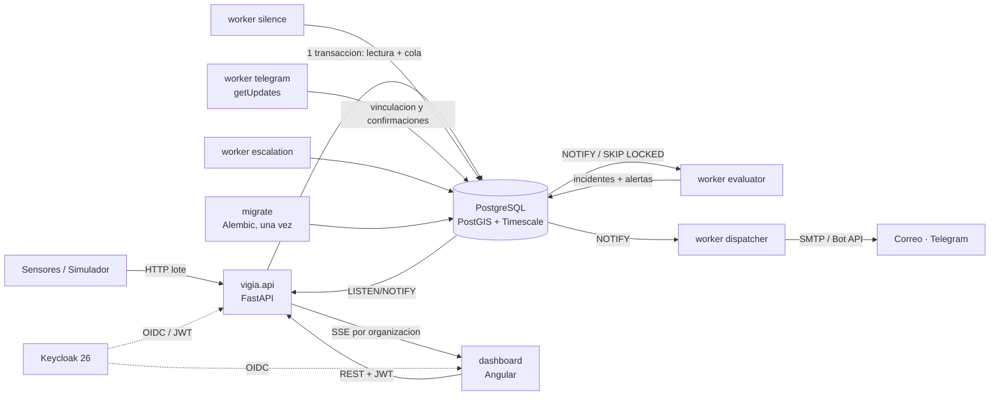
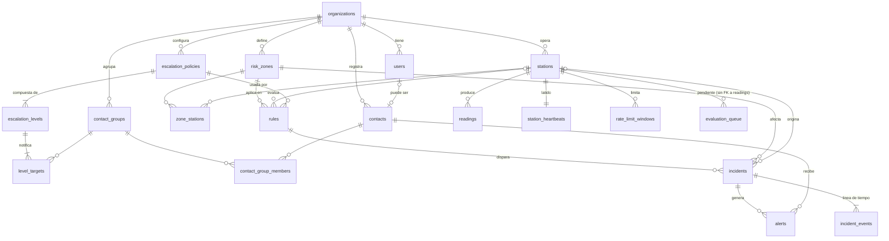

# Vigía (nombre de código) — Especificación del MVP y prompt de desarrollo

Sep 25, 2026 · @Alessandro David

## Visión y problema

Vigía (nombre de código provisional; el producto aún no tiene nombre comercial) reduce de minutos a segundos el tiempo entre que un dato anómalo aparece y los operadores y líderes comunales reciben la alerta, sin depender de una llamada humana.

**Sobre el nombre.** Se descartó "Yaku" porque fue el nombre del ciclón que causó inundaciones graves en el norte del Perú en 2023. También se descartó "SAT" como código porque en Lima es el Servicio de Administración Tributaria. El paquete de código se llama \`vigia\` y no depende del nombre comercial final, que se probará en las entrevistas de validación.

**El problema.** En la inundación de Rasuwa (Nepal, 26 de agosto de 2026) el río se desbordó hacia las 8:40 según el gobierno ([Rising Nepal](https://risingnepaldaily.com/news/85570)). La estación hidrológica Bhote Koshi–Syafrubesi dejó de transmitir hacia las 8:50 y el DHM confirmó la onda de crecida y emitió avisos aguas abajo a las 9:15 ([NDRRMA, SitRep](https://ndrrma.gov.np/mediafiles/rasuwa/Rasuwa_Flood_SitRep_Temp_ENG_01_01092026.pdf)). Pasaron unos 35 minutos, y el silencio de la estación fue la primera señal disponible. Tener sensores no es tener un sistema: falta la capa que conecta datos, reglas y personas.

**La propuesta.** Una plataforma web que ingiere datos de sensores, evalúa reglas configurables y despacha alertas multicanal con escalamiento automático. Trata el silencio de un sensor en zona de riesgo como un posible evento, no como un fallo de mantenimiento.

**Posicionamiento.** Vigía es una herramienta de apoyo para operadores y líderes comunales: detectar, decidir y avisar. No reemplaza la difusión oficial a la población (INDECI, COER regionales, SISMATE del MTC) y está diseñado para integrarse con ella más adelante mediante el estándar CAP.

**Usuarios objetivo.** Oficinas de gestión de riesgo de municipalidades pequeñas y medianas (primer mercado: Perú, por huaicos y Niño costero), ONGs de prevención y operadores de infraestructura crítica (hidroeléctricas, minas).

**Hoja de ruta a largo plazo**

1. MVP (este documento): ciclo dato → regla → incidente → alerta → confirmación.
2. Fase 2: página pública de suscripción ciudadana, SMS, exportación CAP, capa de contexto con pronósticos de caudal.
3. Fase 3 candidata (por confirmar): modelos predictivos, por ejemplo estimar la probabilidad de huaico a partir de lluvia acumulada y caudal. Motivo para mantener el backend en Python.

**Objetivos del MVP**

- Demostrar una alerta de extremo a extremo en menos de 30 s desde que la lectura anómala es aceptada.
- Detectar un sensor silencioso en menos de K × intervalo esperado + 30 s (K = `stations.silence_multiplier`, 3 por defecto).
- Registrar una línea de tiempo auditable de cada incidente, que sobreviva a la expiración de las lecturas.
- Servir como proyecto de portafolio con un backend Python sólido, geoespacial y orientado a eventos.

**Métricas de éxito**

| Métrica | Objetivo MVP | Cómo se mide |
| --- | --- | --- |
| Lectura aceptada → primera alerta enviada | < 30 s (p95) | `alerts.sent_at − readings.received_at` |
| Sensor silencioso → incidente | < K × intervalo + 30 s | `incidents.opened_at − station_heartbeats.last_seen_at` |
| Incidentes confirmados antes de agotar el último nivel | 100 % en la demo (el nivel 2 confirma los dos incidentes) | Por incidente, no por alerta |
| Lecturas procesadas sin pérdida | 100 % con 50 estaciones a 1 lectura/10 s durante 30 min | Cero lecturas con quality = ok y sin evaluated\_at pasados 120 s de recibidas |
| Entrevistas de validación | ≥ 3 antes del sprint 4 | Notas en `docs/research/` |

## Prompt maestro para el agente de desarrollo

Guarda este prompt como `CLAUDE.md` en la raíz del repositorio (única copia) y exporta este documento como `docs/SPEC.md`. El agente de código lee `CLAUDE.md` al iniciar cada sesión.

```markdown
# Rol
Eres un ingeniero de software senior que me acompaña a construir "Vigía" (nombre de código; paquete `vigia`), un sistema de alerta temprana multi-tenant. Yo (desarrollador fullstack) tomo las decisiones de producto; tú propones, implementas y explicas.

# Fuente de verdad
Lee docs/SPEC.md antes de escribir código. Si algo que te pido contradice SPEC.md, avísame antes de continuar. Toda decisión técnica no cubierta se registra como ADR en docs/adr/NNNN-titulo.md.

# Qué es Vigía
Una plataforma web que (1) ingiere lecturas de sensores, (2) evalúa reglas por zona de riesgo (umbral, tasa de cambio, sensor silencioso), (3) abre incidentes sin duplicados y (4) despacha alertas por correo y Telegram con escalamiento automático si nadie confirma. Meta: p95 < 30 s entre lectura recibida y primera alerta enviada.

# Stack obligatorio
- Backend único: Python 3.12, FastAPI, SQLAlchemy 2 async + asyncpg, Pydantic v2, Alembic, uv, Ruff, Mypy (strict), Pytest, structlog, time-machine, uuid-utils (uuid v7 generado en la aplicación).
- Frontend: Angular (versión con soporte activo al iniciar; verificar calendario oficial), standalone components y signals, Leaflet, Tailwind CSS, @microsoft/fetch-event-source para SSE con JWT.
- Infra: PostgreSQL 16 + PostGIS + TimescaleDB (imagen timescale/timescaledb-ha), Keycloak 26 con Organizations, Mailpit para correo local, Docker Compose.
- Sin Redis ni broker externo en el MVP: cola, notificaciones y rate limit viven en Postgres (ver ADR-0002).

# Reglas de arquitectura
- Un paquete `vigia` con módulos: identity, ingestion, territory, rules, incidents, alerts, realtime. Cada módulo con capas domain, application, infrastructure, api. El dominio no importa FastAPI ni SQLAlchemy.
- Esquemas de BD `ingest` y `core` como límite entre módulos; un solo historial de migraciones Alembic. Sin FK hacia la hypertable `ingest.readings`.
- Procesos: `vigia.api` (FastAPI) y workers como procesos separados con el mismo código: `python -m vigia.workers.evaluator`, `.silence`, `.dispatcher`, `.escalation`, `.telegram`. Nunca workers dentro del lifespan de FastAPI.
- Cola: guardar la lectura e insertar en `ingest.evaluation_queue` en la MISMA transacción. El evaluador: (a) toma una fila con `available_at <= now` usando `FOR UPDATE SKIP LOCKED`, incrementa `attempts`, fija `available_at = now + 60 s` (visibility timeout) y confirma en una transacción corta; (b) evalúa en otra transacción que escribe incidentes y alertas, marca `readings.evaluated_at` y borra la fila. Con `attempts` ≥ 5 marca `failed_at` y la saca de la cola. Despierta con `LISTEN/NOTIFY` y polling de respaldo cada 5 s. Envolver la cola en una interfaz `EvaluationQueue`.
- El dispatcher también despierta con `NOTIFY` al crearse alertas, con polling de respaldo cada 5 s.
- Tiempo: todo el dominio recibe un protocolo `Clock` inyectado; prohibido `datetime.now()` fuera de la implementación real. Tests con time-machine o un FakeClock.
- Multi-tenant: el claim `organization` del JWT de Keycloak es un objeto `{alias: {id}}` (scope `organization:*`, mapper con "Add organization id"); se exige exactamente una organización por usuario y se rechaza (403) cualquier token con cero o varias. El tenant se resuelve solo por el `id`. Los roles salen de los realm roles del JWT (Keycloak es la única fuente) y, por la regla anterior, aplican a esa única organización. Toda consulta filtra por `organization_id` mediante una dependencia obligatoria; el canal SSE también filtra por organización.
- Rate limit de ingesta en Postgres (`ingest.rate_limit_windows`), válido con varias réplicas.
- `core.incident_events` y `core.audit_log` son append-only: el rol `vigia_app` no tiene UPDATE ni DELETE sobre ellas. Las migraciones corren con `vigia_owner` y usan `ALTER DEFAULT PRIVILEGES` para que las tablas nuevas otorguen permisos a `vigia_app`.
- Configuración por variables de entorno; nunca secretos en el repositorio.

# Forma de trabajar
1. Antes de cada historia, resume en 3-5 líneas qué harás y qué archivos tocarás; espera mi confirmación.
2. Commits pequeños con Conventional Commits.
3. Explica las decisiones no obvias: quiero aprender, no solo recibir código.
4. Si una tarea supera ~300 líneas, divídela y pregúntame el orden.

# Definición de hecho (DoD)
- Criterios de aceptación cumplidos y demostrables.
- Tests unitarios del dominio + al menos un test de integración por endpoint o worker nuevo (Postgres real vía Docker).
- CI verde: Ruff, Mypy, Pytest, lint y build de Angular.
- `docker compose up` levanta todo sin pasos manuales.
- OpenAPI y docs/SPEC.md actualizados si cambió un contrato.

# Primera tarea (Sprint 0)
Ejecuta VIG-01 a VIG-05 de docs/SPEC.md en orden:
1. Monorepo según SPEC, Makefile (up, down, test, lint, migrate, seed, demo) y CI en GitHub Actions.
2. docker-compose.yml con postgres, keycloak (realm importado de infra/keycloak/realm-vigia.json con 2 organizaciones), mailpit, un servicio `migrate` que corre Alembic una vez y termina, y api, workers y dashboard que dependen de que `migrate` haya terminado con éxito.
3. Script de init de Postgres con roles `vigia_owner`/`vigia_app` y extensiones; migración Alembic inicial: esquemas, tablas, hypertable con compresión y retención, permisos, `ALTER DEFAULT PRIVILEGES` y REVOKE de las tablas append-only.
4. Seed con 2 organizaciones (demo Rímac y una de prueba de aislamiento), zonas, estaciones con API keys generadas e impresas para el simulador, reglas, una política por organización (3 niveles en Rímac) y contactos.
5. Borradores de ADR-0001 a ADR-0004.
Antes del ADR-0004, configura en Keycloak 26 el mapper que incluye el id de la organización en el claim `organization`; el tenant se resuelve solo por ese id.
Al terminar, muéstrame cómo verificar cada punto y propón el siguiente paso.
```

## Alcance del MVP y funcionalidades

El MVP cubre el ciclo completo dato → regla → incidente → alerta → confirmación, con correo y Telegram como canales y un simulador como fuente principal de datos.

| Módulo | Funcionalidad | Detalle |
| --- | --- | --- |
| Ingesta | Recepción de lecturas | `POST /v1/readings` (lote ≤ 500) autenticado con API key por estación; 60 lotes/min por estación |
| Ingesta | Encolado atómico | Lectura y fila en `evaluation_queue` en la misma transacción |
| Ingesta | Lecturas tardías y desordenadas | Se ordenan por `measured_at`; si `received_at − measured_at` > 1 h se guardan con `quality = late`: no se encolan, no entran en ventanas de reglas y no actualizan el latido |
| Ingesta | Simulador | Escenarios normal, subida, caída brusca y apagado de sensor, reproducibles con semilla |
| Ingesta | Latido de estación | `last_seen_at` = `received_at` del último lote con alguna lectura no tardía; `last_value` y `last_measured_at` = la medición no tardía más reciente |
| Territorio | Zonas de riesgo | CRUD de polígonos en mapa, nivel de riesgo, población estimada |
| Territorio | Estaciones | CRUD con ubicación, variable, unidad, intervalo esperado, multiplicador de silencio y API key rotable; el panel marca las estaciones sin zona. La unidad es fija por variable (caudal m3/s, nivel m, lluvia mm) para que una regla nunca compare unidades distintas; el código no cambia tras crear la estación (el nombre sí); al rotar la API key la anterior deja de valer al instante y la nueva se muestra una sola vez |
| Reglas | Umbral | Valor fuera de límite durante N lecturas consecutivas con `quality = ok` (N entre 1 y 60); la frontera es exacta según el operador (`gt`, `ge`, `lt`, `le`) |
| Reglas | Tasa de cambio | Variación mayor a delta en una ventana de T minutos (subida o caída), solo con lecturas `ok`. Se mide del pico al valle respetando el orden (en una caída el pico va antes que el valle; en una subida, al revés), así también dispara una caída brusca que se recupera en parte dentro de la ventana. La ventana va desde T minutos antes de la lectura evaluada hasta ella, ambos extremos incluidos; T entre 1 y 60 |
| Reglas | Sensor silencioso | Se evalúa a partir de las reglas de silencio activas y sus estaciones: sin lectura durante K × intervalo esperado (K solo en `stations.silence_multiplier`); un incidente por estación silenciada; una estación sin zona no genera alertas; una estación que nunca reportó no cuenta como silenciosa (aún no empezó a transmitir); si la estación vuelve a reportar, el worker `silence` registra station\_recovered en su siguiente ciclo y el operador resuelve el incidente (sin cierre automático) |
| Reglas | Enfriamiento | Tras resolver un incidente, la misma causa no reabre otro durante `cooldown_s`; las lecturas se registran igual |
| Incidentes | Apertura sin duplicados | Un solo incidente activo por causa. Mientras está activo, una lectura que sigue disparando la regla se agrega como evento `reading_added` solo si empeora el valor disparador (un nuevo máximo en un umbral superior, un nuevo mínimo en uno inferior o en una caída); igualarlo no cuenta, así que reprocesar una lectura no duplica eventos. La serie completa queda en las lecturas |
| Incidentes | Evidencia | El evento de apertura guarda una copia de las lecturas que dispararon la regla |
| Incidentes | Ciclo de vida | `open` → `acknowledged` → `resolved` (resolución: resuelto o falsa alarma). Un incidente abierto también se puede resolver sin confirmarlo antes (p. ej. una falsa alarma evidente); el evento `resolved` registra quién lo hizo. `resolved` es final |
| Alertas | Correo | SMTP, visible en Mailpit en local. Texto plano con zona, severidad, causa, estación, valor, hora local de la organización y enlace de confirmación; un contacto en dos grupos del mismo nivel recibe una sola alerta por canal. Un envío fallido se reintenta 3 veces (a los 5, 10 y 20 s) y cada fallo queda como `alert_failed`; la línea de tiempo nunca guarda el correo ni el `chat_id` |
| Alertas | Telegram | Vinculación del contacto por enlace de un solo uso: lo genera un admin, se muestra una sola vez y él mismo se lo comparte al contacto por el medio que usen; vale 7 días y uno nuevo invalida el anterior. Mensaje con botón de confirmación; worker con long polling (`getUpdates`). Sin token del bot en el entorno, el worker arranca deshabilitado |
| Alertas | Escalamiento | Si nadie confirma en `wait_s`, contado desde que se avisó a ese nivel, se notifica al siguiente nivel; al agotar el último nivel se registra un evento y el panel muestra el incidente en rojo. El worker lee la política al escalar: los cambios que haga un admin aplican también a los incidentes en curso |
| Alertas | Canal faltante | Si el contacto no tiene el canal del nivel, se omite y se registra; un nivel sin ningún envío escala de inmediato |
| Alertas | Confirmación | Token aleatorio de 256 bits (43 caracteres en base64url, dentro del límite de 64 de Telegram) guardado como hash, un solo uso, 24 h. El enlace del correo abre una página de la API, sin login, con el resumen del incidente y un botón Confirmar (POST): abrir el enlace nunca confirma, porque los escáneres de correo abren los enlaces solos y detendrían el escalamiento. Si el incidente ya estaba confirmado, la alerta queda registrada como vista sin cambiar quién lo confirmó; si ya estaba resuelto, no se cambia nada. Las alertas todavía pendientes de un incidente confirmado o resuelto no se envían: quedan omitidas con su motivo |
| Panel | Mapa en vivo | Zonas por estado, estaciones con último valor y antigüedad, actualización por SSE autenticado y aislado por organización |
| Panel | Detalle de incidente | Gráfico de lecturas, línea de tiempo, alertas por destinatario |
| Seguridad | Identidad y roles | Keycloak 26 Organizations; un usuario pertenece a una sola organización; roles admin, operator, responder, viewer |
| Auditoría | Registro de acciones | Cambios en zonas, estaciones, reglas, políticas y contactos |

**Fuera del MVP:** SMS masivo y WhatsApp, app móvil, página pública de suscripción ciudadana, usuarios en varias organizaciones, exportación CAP (se diseña la entidad de alerta para facilitarla), modelos predictivos, facturación. Open-Meteo queda como capa de contexto opcional (historia "Could"): entrega caudal diario, no ve quebradas pequeñas y su API gratuita es de uso no comercial.

**Escenario de demo obligatorio.** Represamiento simulado en el Rímac: la estación aguas abajo registra una caída brusca de caudal y 4 minutos después la estación aguas arriba deja de reportar. Vigía abre dos incidentes (tasa de cambio y silencio), alerta al nivel 1, escala al nivel 2 por falta de confirmación, el nivel 2 confirma ambos incidentes por Telegram y el panel muestra la línea de tiempo completa.

## Arquitectura

Un backend Python con una API y cinco workers como procesos separados sobre una sola base PostgreSQL, que también hace de cola, canal de notificaciones y almacén del rate limit.



| Componente | Tecnología | Responsabilidad |
| --- | --- | --- |
| `migrate` | Alembic | Contenedor que aplica migraciones y termina; los demás servicios arrancan solo si terminó con éxito |
| `vigia.api` | FastAPI async | Ingesta con rate limit, API de negocio, confirmaciones por enlace, stream SSE |
| `worker evaluator` | Python, asyncpg | Toma lecturas de la cola, evalúa umbral y tasa de cambio, abre o actualiza incidentes y crea alertas |
| `worker silence` | Python | Cada 15 s recorre las reglas de silencio activas y sus estaciones; abre un incidente por estación silenciada |
| `worker dispatcher` | Python, httpx2, aiosmtplib | Despierta con `NOTIFY` al crearse alertas; envía con 3 reintentos exponenciales |
| `worker escalation` | Python | Cada 15 s escala incidentes cuyo nivel venció sin confirmación |
| `worker telegram` | Python, long polling | Vincula `chat_id` de contactos y recibe clics de confirmación |
| `dashboard` | Angular + Leaflet | Mapa, gestión de territorio y reglas, incidentes en vivo |
| PostgreSQL 16 | PostGIS + TimescaleDB | Datos, geometrías, series temporales, cola, notificaciones y rate limit |
| Keycloak 26 | OIDC + Organizations | Usuarios, organización de cada usuario y roles |

**Garantía de no pérdida.** La lectura y su fila en `evaluation_queue` se insertan en la misma transacción. El evaluador procesa cada fila en dos transacciones: 1. Toma una fila con `available_at <= now` usando `SKIP LOCKED`, incrementa `attempts`, fija `available_at = now + 60 s` y confirma. Ese visibility timeout impide que otro evaluador tome la misma fila mientras se procesa, y el contador sobrevive aunque el worker caiga. 2. Evalúa, escribe incidentes y alertas, marca `readings.evaluated_at` y borra la fila. Si el worker muere en el paso 2, todo se revierte y la fila vuelve a estar disponible cuando vence su `available_at`. A los 5 intentos se marca `failed_at`, sale de la cola y el operador ve el fallo en el panel. `evaluated_at` permite verificar que ninguna lectura quedó sin evaluar.

**Tiempo real hacia el panel.** Los workers emiten `NOTIFY vigia_events` con `organization_id` y el id del evento. La API mantiene una conexión `LISTEN` y reenvía por SSE solo a las conexiones de esa organización. El `EventSource` nativo no permite enviar el header `Authorization`, así que el panel usa `@microsoft/fetch-event-source` con el JWT en el header; nunca el token en la URL.

**Rate limit.** Tabla `ingest.rate_limit_windows` con un contador por estación y minuto, actualizada con un upsert atómico. Funciona con varias réplicas de la API sin infraestructura extra.

**Tenant y roles.** Los realm roles de Keycloak 26 son globales. Para el MVP se fija la regla "un usuario pertenece a una sola organización": la API rechaza con 403 tokens con cero o varias organizaciones, y los roles aplican a esa organización. El mapper del client scope `organization` se configura con "Add organization id"; con esa opción Keycloak (verificado en 26.7.4) emite el claim como un **objeto** indexado por alias, `{"rimac": {"id": "<uuid>"}}`, no como una lista. La API exige exactamente una clave y resuelve el tenant solo por su `id`, nunca por el alias. Los clientes piden el scope `organization:*`, que incluye todas las membresías: con `organization` a secas Keycloak pide elegir una organización al usuario, y un usuario con varias pasaría la validación llevando sus roles globales a la que elija (ver ADR-0004). Soportar varias organizaciones por usuario queda para después y exigirá roles por organización.

**Reloj inyectable.** Todo el dominio y los workers reciben un `Clock`. Los tests del detector de silencio y del escalamiento avanzan el tiempo con time-machine o un FakeClock, sin esperas reales.

**Escalado futuro.** API y workers son stateless y escalan horizontalmente (`SKIP LOCKED` reparte el trabajo). Si la carga supera lo que Postgres maneja cómodamente, la interfaz `EvaluationQueue` permite migrar a Redis Streams o Kafka sin tocar el dominio. Un servicio de predicción en Python se sumaría en la fase 3.

## Esquema de base de datos

Una base PostgreSQL 16 con dos esquemas que marcan el límite entre módulos: `ingest` (4 tablas) y `core` (16 tablas), con un solo historial de migraciones Alembic. Las claves primarias son `uuid` v7 generados en la aplicación con `uuid-utils` (PostgreSQL 16 no tiene `uuidv7()` nativo), salvo `incident_events`, `audit_log` y `evaluation_queue` (`bigint` identity); `readings`, `rate_limit_windows`, `zone_stations` y `contact_group_members` (compuestas); `station_heartbeats` (PK `station_id`); y `users`, cuyo `id` es el `sub` que emite Keycloak (uuid, no generado por la aplicación).



### Esquema `core`

| Tabla | Columnas principales | Restricciones clave |
| --- | --- | --- |
| `organizations` | id, keycloak\_org\_id, name, timezone, created\_at | `keycloak_org_id` único; el claim `organization` se resuelve solo contra este id |
| `users` | id (= `sub` de Keycloak), organization\_id, email, full\_name, is\_active, created\_at | `email` único (un usuario, una organización); sin columna de rol: los roles viven solo en Keycloak |
| `risk_zones` | id, organization\_id, name, description, risk\_level, geom `geometry(MultiPolygon,4326)`, population\_estimate, is\_active, created\_at, updated\_at | índice GIST en `geom`; risk\_level ∈ low, medium, high, critical |
| `stations` | id, organization\_id, code, name, variable, unit, location `geometry(Point,4326)`, source, expected\_interval\_s, silence\_multiplier, status, api\_key\_hash, api\_key\_rotated\_at, created\_at | `(organization_id, code)` único; variable ∈ water\_level, discharge, rainfall; source ∈ sensor, simulator; status ∈ active, inactive; `silence_multiplier` por defecto 3 (única fuente de K) |
| `zone_stations` | zone\_id, station\_id, position | PK `(zone_id, station_id)`; position ∈ upstream, in\_zone, downstream |
| `contacts` | id, organization\_id, user\_id (nullable), full\_name, email, telegram\_chat\_id, telegram\_link\_token\_hash, telegram\_link\_expires\_at | `user_id` único si no es nulo |
| `contact_groups` | id, organization\_id, name, zone\_id (nullable) | `(organization_id, name)` único |
| `contact_group_members` | group\_id, contact\_id | PK compuesta |
| `escalation_policies` | id, organization\_id, name, created\_at | `(organization_id, name)` único |
| `escalation_levels` | id, policy\_id, level\_order, wait\_s | `(policy_id, level_order)` único; level\_order ≥ 1 |
| `level_targets` | id, level\_id, contact\_group\_id, channel | channel ∈ email, telegram; `(level_id, contact_group_id, channel)` único |
| `rules` | id, organization\_id, zone\_id, station\_id (nullable), type, params `jsonb`, severity, escalation\_policy\_id, cooldown\_s, is\_active, created\_by, created\_at, updated\_at | type ∈ threshold, rate\_of\_change, silence; severity ∈ info, warning, critical; `params` validado por tipo con Pydantic |
| `incidents` | id, organization\_id, zone\_id, rule\_id, station\_id, status, severity, current\_level, level\_started\_at, trigger\_value, dedup\_key, opened\_at, escalation\_exhausted\_at, acknowledged\_at, acknowledged\_by\_user\_id, acknowledged\_by\_contact\_id, resolved\_at, resolution | status ∈ open, acknowledged, resolved; resolution ∈ resolved, false\_alarm; índice único parcial en `dedup_key` WHERE status IN (open, acknowledged); CHECK: si status = open, ambos `acknowledged_by_*` nulos; si status = acknowledged, exactamente uno no nulo |
| `incident_events` | id, incident\_id, organization\_id, occurred\_at, event\_type, actor\_type, actor\_id, payload `jsonb` | append-only; índice `(incident_id, occurred_at)` |
| `alerts` | id, incident\_id, level\_order, contact\_id, channel, destination, status, attempts, next\_attempt\_at, sent\_at, ack\_token\_hash, ack\_token\_expires\_at, acknowledged\_at, last\_error | status ∈ pending, sent, failed, skipped, acknowledged; índice `(status, next_attempt_at)` |
| `audit_log` | id, organization\_id, actor\_id, entity\_type, entity\_id, action, before `jsonb`, after `jsonb`, at | append-only |

### Esquema `ingest`

| Tabla | Columnas principales | Restricciones clave |
| --- | --- | --- |
| `readings` | station\_id, organization\_id, measured\_at, received\_at, value `double precision`, quality, evaluated\_at | PK `(station_id, measured_at)`; FK a `core.stations` (de la hypertable hacia una tabla normal, soportado); hypertable por `measured_at` (chunks de 1 día); compresión a los 7 días y retención de 180 días; quality ∈ ok, late (una calidad suspect por validación de rango queda para después del MVP) |
| `evaluation_queue` | id, station\_id, measured\_at, organization\_id, enqueued\_at, available\_at, attempts, last\_error, failed\_at | sin FK hacia `readings` (Timescale restringe las FK que apuntan a hypertables); índice parcial en available\_at WHERE failed\_at IS NULL (visibility timeout de 60 s) |
| `station_heartbeats` | station\_id, last\_seen\_at, last\_measured\_at, last\_value, updated\_at | PK `station_id`; `last_seen_at` = `received_at` del último lote con al menos una lectura no tardía (también si era un duplicado: la estación está comunicando); `last_value` es el valor de la medición no tardía más reciente y `last_measured_at` su `measured_at`, para mostrar la antigüedad del dato; ninguno de los dos retrocede con lotes concurrentes o reenvíos antiguos |
| `rate_limit_windows` | station\_id, window\_start, request\_count | PK `(station_id, window_start)`; upsert atómico por lote; el worker silence purga en cada ciclo las ventanas de más de 1 h |

### Cómo se relacionan

- Una **organización** es el tenant y corresponde a una Organization de Keycloak; cada usuario pertenece a una sola y todas las consultas filtran por `organization_id`.
- **Zonas y estaciones** son N:M mediante `zone_stations`; `position` permite reglas como "caída aguas abajo". Una estación sin zona se muestra marcada en el panel y no genera alertas.
- Una **regla** pertenece a una zona, opcionalmente a una estación (si es nula, aplica a todas las estaciones de la zona), y apunta a una **política de escalamiento**.
- Una **política** tiene niveles ordenados; cada nivel notifica a grupos de contacto por un canal. Los **contactos** pueden ser personas sin cuenta o usuarios de la plataforma.
- Un **incidente** nace de una regla en una zona. `dedup_key` impide dos incidentes activos por la misma causa: `rule_id:zone_id` para umbral y tasa de cambio, y `rule_id:zone_id:station_id` para silencio, así cada estación silenciada tiene su propio incidente. `cooldown_s` impide reabrir uno recién resuelto.
- `current_level` indica el nivel de escalamiento y `level_started_at` cuándo se avisó a ese nivel (su `wait_s` cuenta desde ahí); no existe un estado "escalado". Si se agota el último nivel se llena `escalation_exhausted_at`.
- Confirmar cualquier alerta confirma el incidente, detiene el escalamiento y registra quién confirmó (usuario o contacto).
- Las **lecturas** pueden expirar, pero el evento `opened` guarda en su `payload` una copia de las lecturas que dispararon la regla, así que la línea de tiempo sigue siendo auditable.

### Roles de base de datos

- Los roles `vigia_owner` y `vigia_app`, la base `keycloak` y las extensiones (`timescaledb`, `postgis`) los crea el script de `infra/postgres/init/`, que corre como superusuario solo sobre un volumen vacío. Las extensiones no son *trusted* y un rol no puede crearse a sí mismo, así que la migración no puede hacerlo con `vigia_owner`; la migración inicial solo ejecuta `CREATE EXTENSION IF NOT EXISTS` como comprobación (ver ADR-0005).
- `vigia_owner`: dueño de los objetos; solo lo usa el contenedor `migrate`.
- `vigia_app`: usado por API y workers; SELECT, INSERT, UPDATE y DELETE en tablas de negocio, pero solo SELECT e INSERT en `incident_events` y `audit_log`.
- La migración inicial ejecuta `ALTER DEFAULT PRIVILEGES FOR ROLE vigia_owner` en ambos esquemas para que toda tabla futura otorgue permisos a `vigia_app` sin pasos manuales.

### Formato de `rules.params` y eventos

```json
{ "threshold":      { "operator": "gt", "value": 3.5, "consecutive": 2 },
  "rate_of_change": { "direction": "down", "delta": 40.0, "window_minutes": 10 },
  "silence":        {} }
```

`incident_events.event_type` ∈ opened, reading\_added, alert\_sent, alert\_failed, alert\_skipped, escalated, escalation\_exhausted, station\_recovered, acknowledged, resolved, comment.

## Product backlog

32 historias en 10 épicas (E0 a E9): 30 del MVP (125 puntos) y 2 opcionales, VIG-31 y VIG-32, de 3 puntos cada una. Prioridad MoSCoW (M = Must, S = Should, C = Could) y estimación en puntos (1, 2, 3, 5, 8).

| ID | Épica | Historia | Criterios de aceptación | Prio | Pts | Sprint |
| --- | --- | --- | --- | --- | --- | --- |
| VIG-01 | E0 Fundaciones | Como desarrollador quiero un monorepo con Makefile y CI | Estructura según SPEC; `make lint` y `make test` pasan; GitHub Actions ejecuta Ruff, Mypy, Pytest y build de Angular | M | 3 | 0 |
| VIG-02 | E0 Fundaciones | Como desarrollador quiero levantar todo con Docker Compose | `make up` levanta Postgres (con una base separada keycloak para Keycloak), Keycloak, Mailpit, el contenedor `migrate` (corre una vez y termina), la API, 5 workers y el dashboard; API y workers esperan a que `migrate` termine con éxito; healthchecks en verde | M | 5 | 0 |
| VIG-03 | E0 Fundaciones | Como desarrollador quiero la migración inicial y los roles de BD | Roles `vigia_owner` y `vigia_app` y extensiones en el init de Postgres; esquemas, tablas, hypertable, compresión y retención en la migración, con `ALTER DEFAULT PRIVILEGES`; tests: `vigia_app` no puede hacer UPDATE en `incident_events` y sí tiene permisos en una tabla creada por una migración posterior | M | 5 | 0 |
| VIG-04 | E0 Fundaciones | Como desarrollador quiero datos semilla | `make seed` crea 2 organizaciones (demo Rímac y otra de aislamiento), 3 zonas, 10 estaciones con API keys impresas para el simulador, 6 reglas, 5 contactos y una política por organización (3 niveles en Rímac, 1 nivel en la de aislamiento, porque `rules.escalation_policy_id` es obligatoria y las políticas son por organización) | M | 3 | 0 |
| VIG-05 | E0 Fundaciones | Como desarrollador quiero documentar las decisiones iniciales | ADR-0001 a ADR-0004 en `docs/adr/`; el ADR-0004 fija el mapper de Keycloak 26 que incluye el id de la organización en el claim `organization` | M | 2 | 0 |
| VIG-06 | E1 Identidad | Como usuario quiero iniciar sesión y ver solo los datos de mi organización | Login OIDC con Keycloak 26 Organizations; tokens con cero o varias organizaciones reciben 403; test con las 2 organizaciones del seed en cada endpoint | M | 5 | 1 |
| VIG-07 | E1 Identidad | Como admin quiero que cada rol tenga los permisos correctos | Roles leídos del JWT (Keycloak es la única fuente); 403 probado por rol | M | 3 | 1 |
| VIG-08 | E2 Ingesta | Como estación quiero enviar lotes de lecturas autenticadas | `POST /v1/readings` acepta hasta 500 lecturas; API key con hash Argon2id; 401 sin clave, 422 con datos inválidos; 429 al superar 60 lotes/min, contados en `rate_limit_windows` y probado con 2 réplicas de la API | M | 5 | 1 |
| VIG-09 | E2 Ingesta | Como sistema quiero encolar cada lectura de forma atómica | Lectura y fila de `evaluation_queue` en la misma transacción; `NOTIFY`; duplicados por `(station_id, measured_at)` ignorados; lecturas con más de 1 h de retraso marcadas `late` y no encoladas | M | 5 | 1 |
| VIG-10 | E2 Ingesta | Como sistema quiero registrar el latido de cada estación | Upsert en `station_heartbeats` con el `received_at` de la última lectura no tardía; un lote solo con lecturas `late` no actualiza el latido; test de concurrencia | M | 2 | 1 |
| VIG-11 | E2 Ingesta | Como operador quiero un simulador con escenarios | CLI `simulate --scenario normal/rise/drop/silence --stations N --seed S`; escenario Rímac reproducible | M | 5 | 1 |
| VIG-12 | E3 Territorio | Como operador quiero crear y editar zonas de riesgo en el mapa | CRUD REST + dibujo de polígono en Leaflet; validación de geometría; auditoría registrada | M | 5 | 2 |
| VIG-13 | E3 Territorio | Como operador quiero registrar estaciones y asociarlas a zonas | CRUD con posición upstream/in\_zone/downstream; rotación de API key mostrada una sola vez; estaciones sin zona marcadas | M | 5 | 2 |
| VIG-14 | E4 Reglas | Como sistema quiero un worker evaluador confiable | Proceso separado con `SKIP LOCKED` + `LISTEN/NOTIFY` y polling de respaldo; `attempts` se incrementa en una transacción propia antes de evaluar, junto con un visibility timeout de 60 s en available\_at; la evaluación marca `evaluated_at` y borra la fila; tests: matar el worker a mitad de evaluación y verificar reprocesamiento, dos evaluadores nunca procesan la misma fila en paralelo, y una fila que siempre falla llega a `failed_at` al quinto intento; `Clock` inyectado | M | 5 | 2 |
| VIG-15 | E4 Reglas | Como operador quiero reglas de umbral | Dispara tras N lecturas consecutivas `ok` fuera de límite; tests en la frontera | M | 3 | 2 |
| VIG-16 | E4 Reglas | Como operador quiero reglas de tasa de cambio | Detecta subida o caída mayor a delta en la ventana usando solo lecturas `ok`; test del escenario `drop` | M | 5 | 2 |
| VIG-17 | E4 Reglas | Como operador quiero detectar sensores silenciosos | Worker `silence` cada 15 s que parte de las reglas de silencio activas; un incidente por estación silenciada; incidente antes de K × intervalo + 30 s; estación sin zona no alerta; al volver a reportar se registra station\_recovered y el operador resuelve; purga de rate\_limit\_windows en cada ciclo; test con FakeClock | M | 5 | 3 |
| VIG-18 | E5 Incidentes | Como sistema quiero abrir incidentes sin duplicados | Índice único parcial en `dedup_key` (con `station_id` para silencio); respeta `cooldown_s`; el evento `opened` guarda copia de las lecturas disparadoras; test de carrera con 2 evaluadores | M | 5 | 3 |
| VIG-19 | E5 Incidentes | Como operador quiero gestionar el estado de un incidente | Transiciones `open → acknowledged → resolved` (resuelto o falsa alarma); transición inválida devuelve 409; CHECK de `acknowledged_by_*` probado; cada cambio crea un evento | M | 3 | 3 |
| VIG-20 | E6 Alertas | Como contacto quiero recibir la alerta por correo | El dispatcher despierta con `NOTIFY`; plantilla con zona, severidad, valor, hora local y enlace de confirmación; visible en Mailpit | M | 3 | 3 |
| VIG-21 | E6 Alertas | Como contacto quiero vincular mi Telegram | Enlace `t.me/<bot>?start=<token>` de un solo uso (≤ 64 caracteres); el worker `telegram` guarda el `chat_id` al recibir `/start` | M | 3 | 4 |
| VIG-22 | E6 Alertas | Como contacto quiero recibir la alerta por Telegram | Mensaje con botón de confirmación (`callback_data` ≤ 64 caracteres); fallo registra `alert_failed` y reintenta 3 veces | M | 5 | 4 |
| VIG-23 | E6 Alertas | Como contacto quiero confirmar la alerta con un clic | Token aleatorio de 256 bits guardado como hash, un solo uso, 24 h; funciona desde el correo y desde el botón de Telegram; confirmar detiene el escalamiento | M | 3 | 4 |
| VIG-24 | E6 Alertas | Como admin quiero políticas de escalamiento por niveles | CRUD de políticas; worker `escalation` sube de nivel al vencer `wait_s`; canal faltante se omite y registra; al agotar el último nivel se registra `escalation_exhausted` | M | 5 | 4 |
| VIG-25 | E7 Panel | Como operador quiero un mapa en vivo | Zonas por estado, estaciones con último valor y antigüedad; SSE con JWT en header vía `@microsoft/fetch-event-source`, aislado por organización con test; actualización < 2 s | M | 8 | 5 |
| VIG-26 | E7 Panel | Como operador quiero ver el detalle de un incidente | Gráfico de lecturas, línea de tiempo completa, alertas por destinatario | M | 5 | 5 |
| VIG-27 | E7 Panel | Como operador quiero gestionar reglas desde el panel | Formularios por tipo de regla; vista previa con las últimas 24 h de lecturas | S | 5 | 5 |
| VIG-28 | E8 Observabilidad | Como desarrollador quiero medir la latencia de extremo a extremo | Métrica `received_to_alert_seconds`; logs JSON con `correlation_id` desde la lectura hasta la alerta | M | 3 | 6 |
| VIG-29 | E8 Observabilidad | Como desarrollador quiero una prueba de carga | 50 estaciones × 1 lectura/10 s durante 30 min; cero lecturas `ok` sin `evaluated_at` pasados 120 s; p95 < 30 s | S | 3 | 6 |
| VIG-30 | E8 Observabilidad | Como evaluador quiero una demo guiada | `make demo` reproduce el escenario Rímac con confirmación de ambos incidentes en el nivel 2; README con video y capturas | M | 3 | 6 |
| VIG-31 | E9 Contexto | Como operador quiero ver el pronóstico de caudal como contexto en el mapa | Capa informativa con Open-Meteo sin participar en reglas; licencia revisada antes de uso comercial | C | 3 | 6 |
| VIG-32 | E9 Contexto | Como autoridad quiero recibir incidentes en formato CAP | Exportación CAP 1.2 de un incidente; validada contra el esquema oficial | C | 3 | Post-MVP |

## Plan de sprints

Siete sprints de dos semanas, del 28 de septiembre de 2026 al 3 de enero de 2027, pensados para avanzar fuera de tu jornada laboral. Cada sprint cierra con un objetivo demostrable.

| Sprint | Fechas | Objetivo | Historias | Pts |
| --- | --- | --- | --- | --- |
| 0 | 28 sep – 11 oct | Todo levanta con `make up`, migraciones automáticas, CI en verde, datos demo y ADR | VIG-01 a 05 | 18 |
| 1 | 12 – 25 oct | Lecturas autenticadas se encolan de forma atómica por tenant | VIG-06 a 11 | 25 |
| 2 | 26 oct – 8 nov | Zonas, estaciones, evaluador confiable y reglas de umbral y tasa de cambio | VIG-12 a 16 | 23 |
| 3 | 9 – 22 nov | Silencio detectado, incidentes sin duplicados y primer correo | VIG-17 a 20 | 16 |
| 4 | 23 nov – 6 dic | Telegram vinculado, confirmación y escalamiento automático | VIG-21 a 24 | 16 |
| 5 | 7 – 20 dic | Panel en vivo con mapa y detalle de incidente | VIG-25 a 27 | 18 |
| 6 | 21 dic – 3 ene | Latencia medida, prueba de carga y demo Rímac grabada | VIG-28 a 30 (+ VIG-31 si hay tiempo) | 9 (+3) |

**Holgura.** El sprint 1 es el más cargado (25 puntos) y el sprint 6 cae en fiestas. Si un sprint no cierra, mueve VIG-27 y VIG-29 (ambas "Should") antes que recortar calidad en las historias "Must".

**Validación en paralelo.** Antes del sprint 4, entrevista al menos a 3 personas de gestión de riesgo (municipalidades en zonas de huaicos, COER regionales, ONGs de prevención). Pregunta cómo se enteran hoy de un evento, quién avisa a quién, cuánto tarda y qué canal usan. Prueba también las opciones de nombre comercial. Registra cada entrevista en `docs/research/` y ajusta el backlog antes del sprint 5.

**Ceremonias mínimas.** Planificación de 30 min al inicio de cada sprint, demo grabada de 5 min al cierre y una retrospectiva de 3 líneas en `docs/sprints/sprint-N.md`.

## Requisitos no funcionales y seguridad

En un sistema de alertas, una alerta perdida es peor que una duplicada: toda decisión de diseño prioriza entrega garantizada sobre eficiencia.

| Categoría | Requisito | Cómo se verifica |
| --- | --- | --- |
| Latencia | p95 `received_at` de la lectura → `sent_at` de la primera alerta < 30 s | Métrica `received_to_alert_seconds` en la prueba de carga |
| Fiabilidad | Toda lectura `ok` aceptada queda evaluada: lectura y cola en la misma transacción; `evaluated_at` se marca al evaluar | Consulta: cero lecturas `ok` sin `evaluated_at` pasados 120 s (cubre un reintento tras el visibility timeout) |
| Fiabilidad | Una fila que siempre falla no bloquea la cola: `attempts` se confirma antes de evaluar y a los 5 intentos se marca `failed_at` | Test con una lectura que hace fallar al evaluador |
| Fiabilidad | Entrega al menos una vez de alertas, con 3 reintentos exponenciales y registro de fallos | Test con canal simulado que falla 2 veces |
| Idempotencia | Reprocesar una lectura no duplica incidentes ni alertas | Test de doble evaluación de la misma fila |
| Disponibilidad | La caída de un canal (SMTP o Telegram) no detiene a los demás workers | Test de integración con proveedor caído |
| Despliegue | `docker compose up` aplica migraciones automáticamente antes de iniciar API y workers | Arranque desde una base vacía en CI |
| Tiempo | Dominio y workers usan un `Clock` inyectado; todo en UTC en BD y en hora local de la organización en mensajes | Tests con FakeClock y zona America/Lima |
| Multi-tenant | Ningún dato cruza organizaciones, ni por REST ni por SSE; tokens con cero o varias organizaciones se rechazan | Test automatizado con las 2 organizaciones del seed |
| Autenticación | JWT de Keycloak en API, panel y SSE (en header, nunca en la URL); API keys de estación con hash Argon2id y rotables | Tests de 401 y 403; la clave solo se muestra al crearse |
| Confirmaciones | Token aleatorio de 256 bits, guardado como hash, un solo uso, 24 h | Test de reuso y expiración |
| Límite de uso | 60 lotes por minuto por estación, contados en Postgres, válido con varias réplicas | Test con 2 réplicas que recibe 429 |
| Auditoría | `incident_events` y `audit_log` append-only a nivel de permisos de BD; permisos correctos también en tablas futuras | Tests con el rol `vigia_app` |
| Evidencia | La línea de tiempo de un incidente sigue completa aunque las lecturas originales expiren | Test que borra lecturas y consulta el incidente |
| Privacidad | Email y `chat_id` de contactos solo visibles para admin y operator; nunca en logs | Test de serialización por rol y revisión de logs |
| Observabilidad | Logs JSON con `correlation_id` de la lectura al incidente y la alerta; healthcheck en API y cada worker | Trazar un incidente de demo solo con logs |
| Calidad | Cobertura ≥ 80 % en dominio; Ruff, Mypy strict y ESLint sin errores | GitHub Actions |
| Accesibilidad | Panel con WCAG 2.1 AA en vistas principales; el estado nunca se comunica solo por color | axe y Lighthouse en CI |
| Soporte de versiones | Ninguna dependencia principal sale de soporte durante el plan | Revisar calendarios de Python, Angular, PostgreSQL y Keycloak en el sprint 0 |

**Permisos por rol.** Los roles salen de los realm roles del JWT (Keycloak es la única fuente). Cada endpoint declara el permiso que necesita, no una lista de roles; la matriz vive en `vigia/identity/domain/permissions.py` y esta tabla es su especificación. Varios roles suman sus permisos. Un usuario sin ninguno de los cuatro roles solo puede consultar `GET /v1/me`, para que el panel le explique por qué no ve nada.

| Permiso | viewer | responder | operator | admin |
| --- | :-: | :-: | :-: | :-: |
| Ver mapa, zonas, estaciones, reglas e incidentes | ✔ | ✔ | ✔ | ✔ |
| Confirmar incidentes y comentar | | ✔ | ✔ | ✔ |
| Resolver incidentes (resuelto o falsa alarma) | | | ✔ | ✔ |
| Gestionar zonas y estaciones (incluye rotar API keys) | | | ✔ | ✔ |
| Gestionar reglas | | | ✔ | ✔ |
| Ver datos de contacto (email, `chat_id`) | | | ✔ | ✔ |
| Gestionar contactos y grupos | | | | ✔ |
| Gestionar políticas de escalamiento | | | | ✔ |
| Ver auditoría | | | | ✔ |

**Riesgo ético explícito.** Una falsa alarma erosiona la confianza y una alerta perdida puede costar vidas. Vigía es una herramienta de apoyo para operadores y no reemplaza a los sistemas oficiales de alerta; así deben decirlo el producto, la documentación y la demo.

## Repositorio, convenciones y documentación viva

Un monorepo con un backend Python modular, el panel Angular y la documentación versionada junto al código, para que cada cambio de contrato se revise en el mismo pull request.

```text
vigia/
├── backend/
│   ├── src/vigia/
│   │   ├── shared/               # Clock, config, db, tenancy, logging
│   │   ├── identity/
│   │   ├── ingestion/            # API de lecturas, rate limit, simulador
│   │   ├── territory/            # zonas y estaciones
│   │   ├── rules/
│   │   ├── incidents/
│   │   ├── alerts/               # canales, confirmación, escalamiento
│   │   ├── realtime/             # LISTEN/NOTIFY → SSE
│   │   ├── api/main.py           # app FastAPI
│   │   └── workers/              # evaluator, silence, dispatcher, escalation, telegram
│   ├── migrations/               # Alembic (esquemas ingest y core)
│   └── tests/{unit,integration}/
├── dashboard/                    # Angular
├── infra/
│   ├── keycloak/realm-vigia.json
│   └── postgres/init/            # creación de roles vigia_owner y vigia_app
├── docs/
│   ├── SPEC.md                   # este documento
│   ├── adr/
│   ├── research/                 # entrevistas de validación
│   ├── sprints/
│   └── runbooks/
├── docker-compose.yml            # incluye el servicio migrate
├── Makefile
├── CLAUDE.md                     # prompt maestro (única copia)
├── CHANGELOG.md
└── README.md
```

Cada módulo de `src/vigia/` sigue las capas `domain`, `application`, `infrastructure` y `api`. El paquete se llama `vigia` aunque el nombre comercial cambie.

| Artefacto | Propósito | Cuándo se actualiza |
| --- | --- | --- |
| `docs/SPEC.md` | Visión, alcance, arquitectura, esquema, backlog | Al cambiar alcance o contrato |
| `CLAUDE.md` | Prompt maestro y reglas para el agente de código | Al cambiar convenciones o stack |
| `docs/adr/NNNN-*.md` | Una decisión técnica: contexto, opciones, decisión, consecuencias | Cada decisión no trivial |
| OpenAPI generado | Contrato de la API REST | En cada cambio de endpoint (CI falla si no está al día) |
| `CHANGELOG.md` | Cambios visibles por versión (Keep a Changelog + SemVer) | Cada release |
| `docs/runbooks/` | Operación: reprocesar filas con `failed_at`, rotar API keys, restaurar BD | Al añadir un proceso operativo |
| `README.md` | Qué es, cómo levantarlo en 5 minutos, demo y capturas | Al cierre de cada sprint |

**ADR iniciales (sprint 0)**

1. ADR-0001: Backend único en Python con módulos y workers separados; por qué no tres servicios (mantenimiento para una persona, fase predictiva futura).
2. ADR-0002: PostgreSQL como cola (`SKIP LOCKED` + `LISTEN/NOTIFY`), canal de notificaciones y rate limit en lugar de Redis; manejo de filas envenenadas; criterios para migrar.
3. ADR-0003: TimescaleDB para lecturas, con compresión, retención, `evaluated_at` y copia de evidencia en los incidentes. Condiciona el despliegue: Postgres autogestionado (contenedor o VM) o Timescale Cloud, porque AWS RDS no ofrece la extensión y la compresión y la retención están bajo la licencia TSL de Timescale, no Apache.
4. ADR-0004: Keycloak 26 Organizations como fuente de tenant y roles; regla de una organización por usuario; el tenant se resuelve solo por el id de la organización incluido por el mapper.

**Convenciones.** Ramas `feat/VIG-NN-descripcion`; Conventional Commits; pull request con referencia a la historia y checklist de la definición de hecho; tablas y columnas en inglés `snake_case`; documentación en español.
